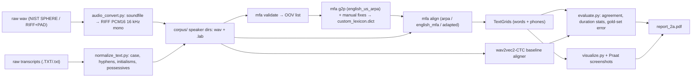
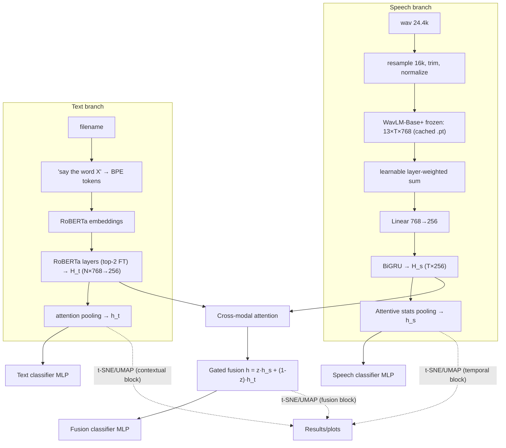
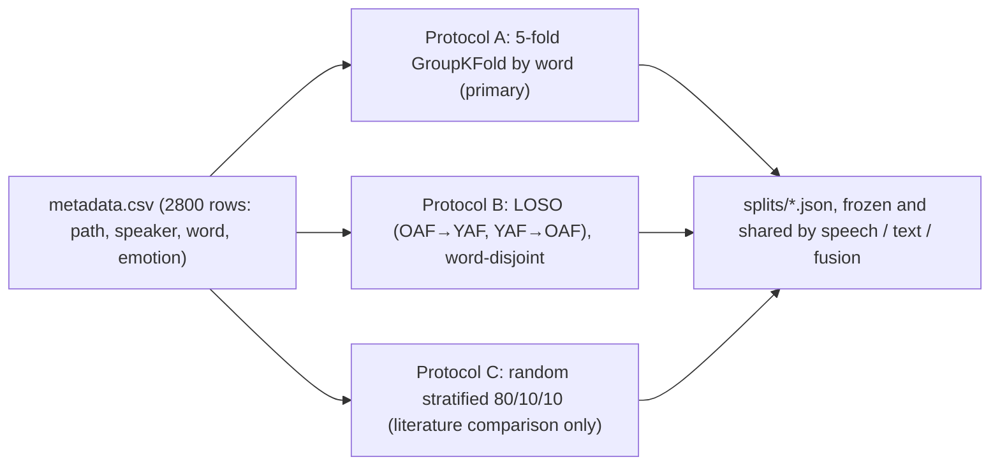

# PLAN.md: IIITH LTRC Speech Lab, Assignment 2 (2A: Forced Alignment · 2B: Multimodal Emotion Recognition)

> **Deadline:** 22 Nov 2026, 23:59 IST · **Plan written:** 20 Nov 2026, ~11:00 IST · **Time available:** about 61 h wall-clock (about 32–36 focused working hours)
> **Status:** PLANNING ONLY. Nothing gets implemented until you approve this plan.

---

## 0. TL;DR: Recommended Approach

| | Primary system | Why it wins | Key differentiator |
|---|---|---|---|
| **2A** | **MFA 3.x** · `english_us_arpa` acoustic + dictionary · custom normalizer and G2P-backed lexicon for out-of-vocabulary (OOV) words | Matches the assignment, has a stable ARPAbet phone set, and GMM-HMM aligners still beat E2E aligners on boundary accuracy (Rousso et al., Interspeech 2024) | One automated pipeline (`make align`) that compares 3 acoustic models (arpa / english_mfa / speaker-adapted). Adds a **wav2vec2-CTC word-alignment baseline**, cross-system boundary-agreement metrics, and **L2 mispronunciation probing** on the ISLE minimal pairs |
| **2B speech** | **Frozen WavLM-Base+ → learnable layer-weighted sum → BiGRU → attentive statistics pooling → MLP** | Self-supervised learning (SSL) layers are the strongest SER features on small data (SUPERB, Pepino 2021). A frozen encoder fits a 4 GB GPU. The BiGRU + attentive pooling is a real temporal block | Baselines: eGeMAPS+SVM and log-Mel CNN-BiGRU. Ablations over layers, pooling and temporal blocks. P1: partial fine-tuning |
| **2B text** | **RoBERTa-base token embeddings → (fine-tuned top layers) contextual Transformer → attention pooling → MLP** | Standard and strong. We **prove analytically and empirically** that TESS text carries no label information, so the expected result is chance (≈14.3%) | Lexical-prior analysis with a zero-shot emotion RoBERTa. P2: Whisper ASR text with punctuation as a "prosody leakage" probe |
| **2B fusion** | **Gated cross-modal attention fusion** (speech frames ↔ text tokens), with concat and late-fusion baselines and modality dropout | Gate values let us **measure** how much the model relies on text. It is robust to an uninformative modality | P1: **alignment-aware fusion**. MFA (from 2A) finds the target-word span in TESS, and the text tells the model *where* to pool. This links 2A and 2B |
| **Evaluation** | **5-fold target-word-disjoint CV** (primary) + **leave-one-speaker-out** (stress test) + random split (for comparison with published numbers, flagged as optimistic) | TESS gives near-ceiling accuracy on random splits. Rigorous splits are where we stand out | Same fold files for all 3 pipelines. Macro-F1/UAR reported as mean ± std. Paired significance tests |

---

## 1. Problem Understanding & Assignment Requirements

### 1.1 Assignment 2A: Forced Alignment with MFA (source: `Assignment_2a.pdf`)
**Objective:** set up and run a full forced-alignment pipeline with MFA and understand how word- and phone-level alignment works.

| # | Requirement (from PDF) | Priority |
|---|---|---|
| A1 | Set up the MFA environment and install MFA | P0 |
| A2 | Organize the provided dataset into MFA corpus format (only the provided data may be used) | P0 |
| A3 | Pick an existing dictionary (e.g. `english_us_arpa`) **or** train one with G2P | P0 |
| A4 | Run forced alignment and produce TextGrids | P0 |
| A5 | Inspect the TextGrids in **Praat**, explain how word and phone boundaries are aligned, and find errors (skipped phones, timing offsets) | P0 |
| A6 | GitHub repo: scripts, setup instructions, outputs. README with install, data-prep and run commands | P0 |
| A7 | **Short PDF report** (sent by email): model and dictionary used, sample alignment visualization, key observations | P0 |
| A8 | **Extra credit:** custom dictionary, multiple acoustic models, full pipeline automation | P1 (all three) |

### 1.2 Assignment 2B: Multimodal Emotion Recognition (source: `Assignment 2b.pdf`)
**Objective:** recognize emotion from (a) speech only, (b) text only, (c) speech + text. The PDF figure fixes the block topology:

- Speech: Preprocessing → Feature extraction → **Temporal modelling** → Classifier
- Text: Preprocessing → Feature extraction → **Contextual modelling** → Classifier
- Multimodal: the two branches up to the temporal/contextual blocks → **Fusion** → Classifier

| # | Requirement | Priority |
|---|---|---|
| B1 | Speech preprocessing: varying length and quality, sampling-rate choice, silence trimming | P0 |
| B2 | Text preprocessing: cleaned and tokenized text | P0 |
| B3 | Feature extraction with shapes `time_steps × features` and `tokens × features` | P0 |
| B4 | Temporal (speech) and contextual (text) modelling | P0 |
| B5 | Fusion into one unified representation, then a classifier | P0 |
| B6 | Code layout **exactly**: `models/{speech,text,fusion}_pipeline/{train,test}.py`, `Results/` (accuracy tables for all 3 variants, `plots/`), `README.md`, `requirements.txt` | P0 |
| B7 | Report A: architecture choice **and justification** for every block | P0 |
| B8 | Report B: comparison of speech-only, text-only and multimodal results | P0 |
| B9 | Report C: easiest and hardest emotions and why, when fusion helps most, **3–5 failure cases**, and **t-SNE/UMAP of the temporal, contextual and fusion block representations** | P0 |
| B10 | Public GitHub repo with scripts, setup, report and results | P0 |

---

## 2. Dataset Analysis & Identified Challenges

### 2.1 2A dataset (inspected directly)

| File | Source corpus | Format (actual) | SR / ch / bits | Duration | Transcript |
|---|---|---|---|---|---|
| `F2BJRLP1.wav` | Boston University Radio News Corpus, speaker **f2b** (female news anchor) | **NIST SPHERE (`NIST_1A`) header, saved with a `.wav` extension** | 16 kHz / mono / 16-bit LE | 25.31 s | ~60 words, mixed case, punctuation, line breaks |
| `F2BJRLP2.wav` | BU Radio | NIST SPHERE | 16 kHz / mono / 16-bit | 28.65 s | ~75 words |
| `F2BJRLP3.wav` | BU Radio | NIST SPHERE | 16 kHz / mono / 16-bit | 30.71 s | ~75 words |
| `ISLE_SESS0131_BLOCKD02_0{1,2,3}_sprt1.wav` | ISLE corpus (non-native learners of English, German/Italian L1) | RIFF WAV with a non-standard `PAD ` chunk (4044 B) | 16 kHz / mono / 16-bit | 4.13 / 3.88 / 4.50 s | `I SAID WHITE NOT BAIT`, `I SAID NEW NOT NO`, `I SAID BAD NOT BED` (uppercase) |

**Challenges and opportunities found:**
1. **Format trap:** Python's `wave` module cannot open the BU files ("file does not start with RIFF id"). MFA's loader may also fail or misread them. → **Preprocessing converts everything to canonical RIFF PCM 16 kHz mono** (libsndfile reads NIST natively). This gets logged and documented, and it is a good point for the report.
2. **Long, multi-sentence utterances (25–31 s)** with pauses. MFA aligns them as single utterances. We may need wider beams (`--beam 100 --retry_beam 400`). As a P1 fallback, we split at punctuation-aligned silences with an initial alignment pass.
3. **Text normalization edge cases:** `S.J.C.'s`, `WBUR's` (initialisms with a possessive), `seventy- six` / `seventy- one` / `thirty- five` (broken hyphen plus space), `de-politicize`, irregular whitespace, and line breaks.
4. **Likely OOV words:** `Dukakis`, `Hennessy`, `Melnicove`, `Maffy`, `WBUR`, `S.J.C.'s`, `de-politicize`, maybe `judgeships`. → G2P plus manual verification.
5. **ISLE = L2 speech + minimal pairs:** the speaker may actually say the *other* member of the pair (e.g. "bed" for "bad"), so the canonical dictionary may not match the audio. → This is a great analysis opportunity (Section 7.1, A-P1-4).
6. **No gold alignments provided** (the BU corpus has hand-labelled phones, but the assignment forbids outside data). → Quantitative evaluation has to use proxies: cross-system agreement, a small manual gold set made in Praat, and duration plausibility.
7. **Licensing:** BU Radio (LDC) and ISLE (ELRA) audio is licensed. → **Recommend not committing the raw audio** to the public repo. Commit the scripts, transcripts-derived artifacts and TextGrids (required outputs). *(This needs your decision; see open questions.)*

### 2.2 2B dataset: TESS (from the dataset description and literature; to be verified in the data audit, phase B1)

| Property | Value |
|---|---|
| Size | **2800** clips = 200 target words × 7 emotions × 2 speakers |
| Speakers | 2 female native Canadian-English actresses: **OAF (aged 64)** and **YAF (aged 26)**. Both musically trained with normal hearing |
| Emotions | anger, disgust, fear, happiness, pleasant surprise, sadness, neutral. **Perfectly balanced: 400 clips per class** |
| Text | Carrier phrase **"Say the word ___"**. Target words come from NU-6 (Northwestern University Auditory Test No. 6), so they are phonetically balanced and emotionally neutral by design. Kaggle has **no transcript files**: text comes from the filename (`OAF_back_angry.wav` → "Say the word back") |
| Audio | WAV, 24.414 kHz (expected), ~1.5–2.5 s, studio quality |
| License | CC BY-NC-ND 4.0 (do **not** redistribute audio) |
| Sources | Kaggle (link in the PDF) and the UofT Borealis Dataverse (DOI `10.5683/SP2/E8H2MF`) |

**Critical scientific observations:**
1. **Text has zero label information by construction.** Every transcript appears with all 7 emotions for both speakers, so P(emotion | text) = 1/7 for every text. The Bayes-optimal text-only classifier is at **chance (14.29%)** under *any* split. A text model doing better than chance would mean leakage or a bug. This is a falsifiable sanity check, and a strong point to raise in an interview.
2. **Acted, exaggerated, clean speech** with 2 speakers. Random-split SER accuracy on TESS is commonly reported near ceiling (~97–100%). Those numbers mostly reflect **speaker and lexical memorization**, not generalization.
3. **Leakage vectors:** (a) the same target word in train and test (the lexical/phonetic content is identical, only prosody differs); (b) the same speaker in train and test (only 2 exist); (c) per-utterance duration and loudness differences between emotions (e.g. sad = long and quiet) that silence trimming or normalization can expose or hide; (d) the speaker's identity correlates with recording session, so channel cues might be learned.
4. **Speaker independence is very limited:** with only 2 speakers, leave-one-speaker-out (LOSO) means 2 folds with a large age and voice gap. It is a *stress test*, not a reliable generalization estimate. We report it honestly with this caveat.
5. **Known Kaggle quirks (to audit):** folder names are inconsistent (`OAF_Pleasant_surprise` vs `YAF_pleasant_surprised`, `OAF_Fear` vs `YAF_fear`), and a few files may be mislabelled or have filename typos. → The audit script normalizes labels and checks all 200×7×2 combinations.
6. **Pretrained-model contamination:**
   - **EmoBox** (Interspeech 2024) includes TESS. **emotion2vec+** models were fine-tuned on EmoBox-derived data (the *seed* model), so **emotion2vec+ is contaminated** → excluded from headline results, comparison only, flagged.
   - emotion2vec (base) was pre-trained self-supervised on emotion corpora. TESS inclusion is not confirmed → used as a *secondary* comparison only, with a caveat.
   - **WavLM / HuBERT / wav2vec2** were pre-trained on LibriLight / GigaSpeech / VoxPopuli / LibriSpeech with no emotion labels → **clean, primary choice**.
   - Many Hugging Face "SER" checkpoints were fine-tuned on TESS/RAVDESS → **not used**.

---

## 3. Research Findings & References

### 3.1 Forced alignment
| Work | Finding relevant to us | Link |
|---|---|---|
| McAuliffe et al., *Montreal Forced Aligner*, Interspeech 2017 | Kaldi GMM-HMM triphone aligner with speaker adaptation (fMLLR). Strong boundary accuracy on Buckeye/TIMIT | [ISCA](https://www.isca-archive.org/interspeech_2017/mcauliffe17_interspeech.html) |
| MFA 3.x docs and pretrained models | `english_us_arpa` (ARPAbet, stress marked), `english_mfa` (IPA-like MFA phone set, larger training data), G2P models, `mfa validate/align/g2p/adapt/train` | [docs](https://montreal-forced-aligner.readthedocs.io/) · [models](https://mfa-models.readthedocs.io/) · [GitHub](https://github.com/MontrealCorpusTools/Montreal-Forced-Aligner) |
| Rousso, Cohen, Keshet, Chodroff, *Tradition or Innovation*, Interspeech 2024 | **MFA beats WhisperX and MMS** on word and phone boundary accuracy (TIMIT, Buckeye). Supports keeping MFA primary and using E2E as a baseline only | [arXiv 2406.19363](https://arxiv.org/abs/2406.19363) ✅ |
| Zhu et al., *Charsiu*, ICASSP 2022 | wav2vec2-based frame-classification phone aligner, competitive with MFA on TIMIT | [arXiv 2110.03876](https://arxiv.org/abs/2110.03876) ✅ · [GitHub](https://github.com/lingjzhu/charsiu) |
| Pratap et al., *MMS*, 2023 | CTC forced alignment with a multilingual wav2vec2 (char level) | [arXiv 2305.13516](https://arxiv.org/abs/2305.13516) |
| Bain et al., *WhisperX*, Interspeech 2023 | wav2vec2 CTC realignment of Whisper output (word level only) | [arXiv 2303.00747](https://arxiv.org/abs/2303.00747) |
| Kürzinger et al., *CTC-Segmentation*, SPECOM 2020 | CTC-based alignment of long audio | [arXiv 2007.09127](https://arxiv.org/abs/2007.09127) |
| torchaudio `forced_align` | Deprecated in 2.8, **removed in 2.9** → pin `torchaudio<2.8` or use HF CTC + our own Viterbi | [issue #3902](https://github.com/pytorch/audio/issues/3902) ✅ |
| Tools | `praatio` (TextGrid I/O), `parselmouth` (Praat in Python) | [praatIO](https://github.com/timmahrt/praatIO) · [Parselmouth](https://github.com/YannickJadoul/Parselmouth) |

### 3.2 Speech emotion recognition
| Work | Relevance | Link |
|---|---|---|
| Eyben et al., *eGeMAPS*, IEEE TAC 2016 | Standard 88-dim interpretable acoustic parameter set → classical baseline | [doi](https://doi.org/10.1109/TAFFC.2015.2457417) · [opensmile-python](https://github.com/audeering/opensmile-python) |
| Baevski et al., *wav2vec 2.0*, NeurIPS 2020 | SSL speech foundation model | [arXiv 2006.11477](https://arxiv.org/abs/2006.11477) |
| Hsu et al., *HuBERT*, TASLP 2021 | SSL with masked prediction of cluster targets | [arXiv 2106.07447](https://arxiv.org/abs/2106.07447) |
| Chen et al., *WavLM*, IEEE JSTSP 2022 | Denoising masked prediction plus gated relative position bias. **Best SUPERB ER among base-size models**. Strong on paralinguistics | [arXiv 2110.13900](https://arxiv.org/abs/2110.13900) · [HF wavlm-base-plus](https://huggingface.co/microsoft/wavlm-base-plus) |
| Yang et al., *SUPERB*, Interspeech 2021 | Frozen upstream + learnable weighted layer sum + light downstream = standard protocol | [arXiv 2105.01051](https://arxiv.org/abs/2105.01051) |
| Pepino, Riera, Ferrer, Interspeech 2021 | wav2vec2 embeddings + trainable layer weights + shallow downstream beat eGeMAPS on IEMOCAP/RAVDESS | [arXiv 2104.03502](https://arxiv.org/abs/2104.03502) ✅ |
| Pasad et al., *Layer-wise analysis of SSL models*, ASRU 2021 | Middle layers hold the most phonetic and paralinguistic information → motivates layer analysis | [arXiv 2107.04734](https://arxiv.org/abs/2107.04734) |
| Wagner et al., *Dawn of the Transformer Era in SER*, IEEE TPAMI 2023 | Fine-tuned transformers implicitly learn linguistic information. Robustness and fairness analysis | [arXiv 2203.07378](https://arxiv.org/abs/2203.07378) ✅ |
| Ma et al., *emotion2vec*, ACL Findings 2024 | Emotion-specific SSL representation | [arXiv 2312.15185](https://arxiv.org/abs/2312.15185) ✅ · [GitHub](https://github.com/ddlBoJack/emotion2vec) |
| Ma et al., *EmoBox*, Interspeech 2024 | 32-dataset SER benchmark **including TESS** → contamination evidence for emotion2vec+ | [arXiv 2406.07162](https://arxiv.org/abs/2406.07162) ✅ · [GitHub](https://github.com/emo-box/emo-box) |
| Okabe et al., *Attentive Statistics Pooling*, Interspeech 2018 | Attention-weighted mean + std pooling for utterance embeddings | [arXiv 1803.10963](https://arxiv.org/abs/1803.10963) |
| Desplanques et al., *ECAPA-TDNN*, Interspeech 2020 | Strong 1D-CNN temporal model (ablation candidate) | [arXiv 2005.07143](https://arxiv.org/abs/2005.07143) |
| Park et al., *SpecAugment*, Interspeech 2019 | Time/frequency masking augmentation | [arXiv 1904.08779](https://arxiv.org/abs/1904.08779) |
| Pichora-Fuller & Dupuis, *TESS*, 2020 | Dataset reference | [Borealis](https://doi.org/10.5683/SP2/E8H2MF) · [Kaggle](https://www.kaggle.com/datasets/ejlok1/toronto-emotional-speech-set-tess) |

### 3.3 Text and multimodal fusion
| Work | Relevance | Link |
|---|---|---|
| Liu et al., *RoBERTa*, 2019 | Text encoder | [arXiv 1907.11692](https://arxiv.org/abs/1907.11692) · [HF](https://huggingface.co/FacebookAI/roberta-base) |
| Hartmann, *Emotion English DistilRoBERTa-base* | 7 Ekman classes (anger, disgust, fear, joy, neutral, sadness, surprise), which **map 1:1 onto TESS** → zero-shot lexical-prior probe | [HF](https://huggingface.co/j-hartmann/emotion-english-distilroberta-base) |
| Zadeh et al., *Tensor Fusion Network*, EMNLP 2017 | Outer-product fusion (ablation candidate) | [arXiv 1707.07250](https://arxiv.org/abs/1707.07250) |
| Arevalo et al., *Gated Multimodal Units*, ICLR-W 2017 | Gate-based fusion with interpretable modality weights | [arXiv 1702.01992](https://arxiv.org/abs/1702.01992) |
| Tsai et al., *MulT*, ACL 2019 | Directional cross-modal attention | [arXiv 1906.00295](https://arxiv.org/abs/1906.00295) |
| Hazarika et al., *MISA*, ACM MM 2020 | Modality-invariant/specific representations | [arXiv 2005.03545](https://arxiv.org/abs/2005.03545) |
| McInnes et al., *UMAP*, 2018 · van der Maaten & Hinton, *t-SNE*, JMLR 2008 | Embedding visualization | [arXiv 1802.03426](https://arxiv.org/abs/1802.03426) · [JMLR](https://www.jmlr.org/papers/v9/vandermaaten08a.html) |

✅ = existence and ID confirmed via web search during planning. The others are well-known IDs and will be re-checked when the report bibliography is written.

---

## 4. Candidate Architecture Comparisons

### 4.1 2A: alignment systems
| System | Granularity | Strengths | Weaknesses | Role |
|---|---|---|---|---|
| **MFA `english_us_arpa`** | word + phone (ARPAbet + stress) | Required tool. CMUdict-style lexicon, robust, fMLLR adaptation | 10 ms frames, so minimum phone duration ≈30 ms. Dictionary-bound | **Primary** |
| MFA `english_mfa` + `english_us_mfa` dict | word + phone (MFA phone set) | More training data, finer phone set, pronunciation variants | Phone set differs → needs a mapping table to compare phones | Comparison #1 |
| MFA `adapt` (arpa → our 6 files) | word + phone | MAP adaptation to the speakers | Tiny data (~97 s) → risk of overfitting; must show the change is a gain, not noise | Comparison #2 (P1) |
| MFA `train` from scratch | word + phone | Demonstrates the full pipeline | ~97 s of data is far too little → expected to degrade | P2 negative-result demo |
| wav2vec2-CTC (torchaudio MMS_FA, pinned <2.8) | word (char-level CTC) | Modern E2E, no lexicon | Peaky CTC → boundary bias. No phones | Modern baseline (P1) |
| Charsiu / wav2vec2-phoneme CTC | phone | Modern phone aligner | Extra dependency risk | P2 |

### 4.2 2B: per-block candidates (✔ = selected)

**Speech preprocessing:** resample to **16 kHz** ✔ (SSL models' native rate; TESS is 24.4 kHz) · mono ✔ · trim leading/trailing silence with `librosa.effects.trim(top_db≈30)` ✔ (energy-VAD and no-trim as ablations) · loudness/peak normalization ✔ (prevents a loudness shortcut; ablate) · dynamic padding + attention mask ✔ (better than fixed crop, since clips are short at ~2 s).

**Speech feature extraction (`T × D`):**
| Candidate | D | Pros | Cons | Verdict |
|---|---|---|---|---|
| eGeMAPS LLDs / functionals | 25 LLD / 88 func | Interpretable, classical | Limited capacity | ✔ Classical baseline (SVM) |
| log-Mel (80) + Δ | 80–240 | From scratch, no contamination | Needs more data | ✔ DL baseline |
| **WavLM-Base+ (frozen, all 13 layers)** | 13×768 | Best paralinguistic base-size SSL. Fits in 4 GB. Clean pre-training data | Frozen = no task-specific adaptation | ✔ **Primary** |
| HuBERT-base / wav2vec2-base | 13×768 | Comparable SSL | Slightly weaker on SUPERB ER | ✔ Ablation |
| WavLM-Large (fp16 inference) | 25×1024 | Larger | 3× compute. Diminishing returns on 2800 clips | P1 ablation (feature caching makes it cheap) |
| emotion2vec base | 768 | Emotion-specific | Contamination unclear | P2 comparison, flagged |
| emotion2vec+ | — | — | **Fine-tuned on EmoBox, which includes TESS** | ✘ Excluded (or flagged-only) |

**Speech temporal modelling:** Mean pooling (no temporal; lower-bound ablation) · **BiGRU (1 layer, 128/dir) + attentive statistics pooling ✔** (few parameters, good on short sequences, gives an inspectable attention map) · 2-layer Transformer encoder + ASP (ablation) · ECAPA-style 1D-CNN (ablation) · BiLSTM (ablation, similar to BiGRU). *Why BiGRU:* about 2800 utterances × ~100 frames. A small recurrent block has the right inductive bias and fewer parameters to overfit, and SSL features are already contextualized, so a deep Transformer adds little.

**Text preprocessing:** derive the transcript from the filename → "say the word {w}" · lowercase, strip, unify filename typos · RoBERTa BPE tokenization with `<s>`/`</s>`.

**Text feature extraction (`N × D`):** TF-IDF / one-hot (classical, ✔ baseline) · GloVe-300 (static, ✔ ablation) · **RoBERTa-base token embeddings ✔** · emotion-DistilRoBERTa (emotion-aware init, ✔ ablation and zero-shot probe).

**Text contextual modelling:** **RoBERTa Transformer layers (frozen, then top-2 fine-tuned) + attention pooling ✔** · BiLSTM over static embeddings (ablation). The task says "learn emotional meaning across tokens in context", which is exactly what self-attention does.

**Fusion:**
| Candidate | Pros | Cons | Verdict |
|---|---|---|---|
| Early/feature concat + MLP | Simple, strong baseline | No interaction | ✔ Baseline F1 |
| Late (decision) fusion: weighted logit average | Robust, modular | No feature interaction | ✔ Baseline F2 |
| Tensor fusion (TFN) | Captures bimodal interactions | d² parameters → overfits on 2800 samples | P2 |
| **Gated cross-modal attention** ✔ | Speech frames attend to text tokens (and vice versa), then a GMU-style scalar/vector gate z ∈ [0,1] mixes modalities. **The gate is directly interpretable** ("how much text is used") | Slightly more complex | ✔ **Primary F3** |
| MulT (full) | SOTA on CMU-MOSEI | Heavy for 2800 clips | ✘ (cited, not used) |
| **Alignment-aware pooling** (text → word spans from MFA → span-wise pooling of speech) | Uses text as *structure*, not semantics. Directly useful on TESS | Needs MFA on TESS (minutes) | ✔ P1 F4 |

**Classifier:** 2-layer MLP (256 → 7), dropout 0.3, label smoothing 0.1, softmax/CE ✔. SVM/LogReg on frozen pooled embeddings is a linear-probe baseline.

---

## 5. Recommended Architectures & Justification

### 5.1 2A: MFA pipeline
- **Acoustic model:** `english_us_arpa` (primary). It matches the PDF's example dictionary, gives an ARPAbet phone set that is easy to read in Praat, has stress markers for analysis, and the US-English training data suits the BU (Boston) speaker. `english_mfa` is the comparison.
- **Dictionary:** `english_us_arpa` + **custom lexicon extension**. OOVs from `mfa validate` → `mfa g2p` (english_us_arpa G2P) → **manual verification** of proper nouns (e.g. *Dukakis* `D UW0 K AA1 K IH0 S`, *Hennessy* `HH EH1 N AH0 S IY0`) → merged `custom_lexicon.dict`. Initialisms (`WBUR`, `S.J.C.`) are normalized to letter sequences and get letter pronunciations.
- **Settings:** default 2-pass fMLLR speaker adaptation, per-speaker grouping (`f2b`, `isle_sess0131`), `--clean`, `--beam 100 --retry_beam 400` for the long BU files, `--output_format long_textgrid`, `--use_mp` with 6 jobs.

### 5.2 2B: Final systems
- **S\*** (speech): `wav 16k → trim/normalize → WavLM-Base+ (frozen, all hidden states cached) → softmax-weighted layer sum (13 learnable scalars) → Linear(768→256)+LayerNorm+Dropout → BiGRU(256→2×128) → AttentiveStatsPool (512→512) → MLP(512→256→7)`. About 0.6 M trainable parameters.
- **T\*** (text): `transcript → RoBERTa tokenizer → RoBERTa-base (top-2 layers fine-tuned) → attention pooling over tokens → MLP(768→256→7)`.
- **F\*** (fusion): S\* temporal output `H_s ∈ R^{T×256}` and T\* contextual output `H_t ∈ R^{N×256}` (projected) → bidirectional cross-attention (4 heads, 1 layer) → pooled `h_s`, `h_t` → **gated fusion** `h = z⊙h_s + (1−z)⊙h_t`, `z = σ(W[h_s;h_t])` → MLP → 7 classes. **Modality dropout** (p = 0.2 per modality) during training. Optional auxiliary unimodal heads.

**Why this is the right size:** 2800 clips, 4 GB GPU, ~2 days. Frozen SSL + feature caching makes each training run **seconds to a few minutes**, which lets us run 5-fold CV × many ablations × 3 seeds. That is far more scientific value than one fine-tuned giant model. Fine-tuning (P1) is a measured ablation, not the default.

---

## 6. Architecture Diagrams & Data Flow

### 6.1 2A pipeline


### 6.2 2B pipelines


### 6.3 Evaluation protocol


---

## 7. Implementation Strategy for Every Functional Block

### 7.1 2A blocks
| Block | Implementation | Detail |
|---|---|---|
| Audio conversion | `soundfile.read` (libsndfile supports NIST) → check SR, channels, clipping → write RIFF PCM16 | Assert duration = `sample_count/16000`. Log the original format |
| Text normalization | Rule-based, unit-tested: join `seventy- six` → `seventy-six`. `S.J.C.'s` → `S J C's` (or `SJC's` with a custom entry). `WBUR's` → `W B U R's`. Strip punctuation except apostrophes and intra-word hyphens. Collapse whitespace. Keep the original text as a sidecar file for the report | Write `.lab` files with identical basenames |
| Corpus layout | `corpus/f2b/F2BJRLP*.{wav,lab}`, `corpus/isle_s0131/ISLE_*.{wav,lab}` | Speaker dirs enable per-speaker fMLLR |
| Dictionary | `mfa validate` → `oov_*.txt` → `mfa g2p` → hand-check → `custom_lexicon.dict` (merged with base dict via `mfa model add_words` or a combined dict file) | Report which words were OOV and the before/after |
| Alignment | `mfa align corpus dict acoustic out --clean --beam 100 --retry_beam 400 -j 6` (+ `--config_path` YAML) | One run per model config → `outputs/<model>/` |
| Visualization | parselmouth spectrogram + waveform + word/phone tiers (matplotlib PNG). Plus **real Praat screenshots** (you open the files in Praat; I provide a `.praat` script that opens wav+TextGrid pairs) | Required: "check TextGrids using Praat" |
| Evaluation | See Section 9.1 | |
| **L2 probe (ISLE)** | Add the alternative pronunciations of the minimal-pair words to a "probe dictionary" (e.g. BAD → `B AE1 D` / `B EH1 D`, WHITE → `W AY1 T` / `V AY1 T` (typical German L1 /w/→/v/), NEW → `N UW1` / `N Y UW1`). MFA picks the most likely variant per token → shows **which pronunciation the learner actually produced**, with per-variant likelihoods | Presented as an alignment-based pronunciation-assessment demo, with caveats (GMM-HMM, no ground truth) |

### 7.2 2B blocks
| Block | Implementation |
|---|---|
| Data audit | `prepare_tess.py`: walk folders, parse `{SPK}_{word}_{emotion}.wav`, normalize labels (`ps`/`pleasant_surprised` → `surprise`), verify 200×7×2 completeness, find duplicates (MD5), and collect SR, duration and RMS stats per class → `metadata.csv` + `data_audit.md` + plots |
| Splits | `make_splits.py`: GroupKFold(5) on word with a fixed seed, plus an inner validation fold of words. LOSO and random splits saved as JSON. Assertions: no word overlap (A), no speaker overlap (B), balanced classes |
| Speech preprocessing | torchaudio/librosa resample → trim (top_db 30, padding 50 ms) → peak normalize to −1 dBFS (ablation: none / LUFS) → cache 16 k waveforms |
| Feature caching | `extract_features.py`: run the SSL model once per clip in fp16, save all hidden states as `float16 [L, T, D]` → about 2800 × 13 × 100 × 768 × 2 B ≈ **5.6 GB for WavLM-Base+** (fine on D:, 84 GB free). Also eGeMAPS (opensmile) and log-Mel |
| Speech model | `src/mer/models/speech.py`: `LayerWeightedSum`, `TemporalEncoder` (gru / lstm / transformer / cnn / none via config), `AttentiveStatsPool`, `MLPHead`. Forward returns `{"logits", "temporal_emb"}` |
| Text model | `src/mer/models/text.py`: HF `AutoModel` with frozen layers set by `n_finetune_layers`, `AttnPool`, `MLPHead`. Returns `{"logits", "contextual_emb"}` |
| Fusion model | `src/mer/models/fusion.py`: reuses the speech and text encoders. `fusion_type ∈ {concat, late, gated_xattn, align_pool}`. Modality dropout. Returns `{"logits", "fusion_emb", "gate"}` |
| Training | Shared `trainer.py`: AdamW, cosine schedule with warmup, early stopping on **validation macro-F1** (inner word-disjoint fold), grad clip 1.0, AMP, seeds {0,1,2}. Log to CSV + TensorBoard |
| Testing | `test.py` loads the best checkpoint per fold → predictions CSV (path, true, pred, probs) → metrics, confusion matrix, embeddings `.npy` |
| Visualization | `plots.py`: t-SNE (perplexity 30, PCA-50 init) and UMAP, colored by emotion with marker by speaker, plus silhouette score and kNN accuracy per block |

---

## 8. Training & Experimental Design

### 8.1 Protocols (consistent across all pipelines)
- **A (primary): 5-fold target-word-disjoint CV**. 160 train words (of which 32 are validation words) and 40 test words per fold. Both speakers in train and test. Measures generalization to **unseen lexical content**.
- **B (stress test): LOSO + word-disjoint.** Train on speaker X with words W_train, test on speaker Y with W_test. Measures **cross-speaker** generalization (2 folds; high variance, reported as such).
- **C (reference): random stratified split.** Only for comparison with published numbers, **explicitly flagged as optimistic** because of word and speaker overlap.
- All reported numbers are mean ± std over folds (× 3 seeds for headline models). Hyperparameters are tuned **only on inner validation folds**, never on test.

### 8.2 Experiment matrix
| ID | Pipeline | Experiment | Priority |
|---|---|---|---|
| E1 | Speech | eGeMAPS functionals + SVM (RBF), Protocols A/B/C | P0 (classical baseline) |
| E2 | Speech | log-Mel → CNN + BiGRU + ASP (from scratch) | P1 |
| E3 | Speech | **S\***: WavLM-Base+ frozen, weighted layers, BiGRU + ASP | **P0** |
| E4 | Speech | Upstream ablation: wav2vec2-base, HuBERT-base, WavLM-Base+, WavLM-Large | P1 |
| E5 | Speech | Temporal ablation: mean-pool / BiGRU / BiLSTM / Transformer / CNN; ASP vs mean | P1 |
| E6 | Speech | Layer analysis: single-layer linear probes (13 layers) + learned layer weights plot | P1 |
| E7 | Speech | Preprocessing ablation: trim vs no-trim, normalization on/off | P2 |
| E8 | Speech | Partial fine-tuning of the top-4 WavLM layers (LLRD, fp16, batch 8) | P1 |
| E9 | Text | TF-IDF + LogReg | P0 (classical baseline) |
| E10 | Text | **T\***: RoBERTa, frozen vs top-2 fine-tuned | **P0** |
| E11 | Text | Zero-shot emotion-DistilRoBERTa on "say the word X" and on "X" alone → lexical-prior analysis | P1 |
| E12 | Text | Whisper-small ASR transcripts (punctuation/casing kept) as text input → does ASR punctuation leak prosody? | P2 |
| E13 | Fusion | F1 concat, F2 late fusion, **F3 gated cross-attention** | **P0** (F3 + one baseline) |
| E14 | Fusion | F4 alignment-aware pooling (MFA spans on TESS: carrier vs target word) | P1 |
| E15 | Fusion | Robustness: test-time additive noise (white/pink at 20/10/0 dB), speech masking, text replacement/shuffle → modality reliance curves | P1 |
| E16 | All | Paired significance (McNemar / paired bootstrap on per-clip predictions) S\* vs F\* | P1 |
| E17 | Speech | emotion2vec base/+ features, **flagged as contamination-risk** | P2 |

### 8.3 Hyperparameters (initial; tuned on inner validation only)
Speech/fusion heads: AdamW lr 1e-3 (heads) / 2e-5 (fine-tuned SSL/RoBERTa layers), wd 1e-2, batch 32, ≤40 epochs, patience 8, dropout 0.3, label smoothing 0.1. Augmentation (frozen-feature setting): SpecAugment-style time/feature masking on cached features. Speed perturbation is P2, since it needs re-extraction.

### 8.4 Hypotheses (to test, **not** assumed)
- H1: S\* ≫ eGeMAPS+SVM under Protocol A. Both are near ceiling under C.
- H2: Text-only ≈ chance (14.3% acc, macro-F1 ≈ 0.14) under every protocol. Deviation means a bug or leakage.
- H3: Fusion ≈ speech-only. The gate z → ~1 (speech-dominant). Fusion may slightly **hurt** through overfitting. F4 (alignment-aware) may help because text provides *structure*.
- H4: The LOSO drop is large (age and voice gap). Confusions concentrate on happy ↔ pleasant surprise and neutral ↔ sad (shared arousal/valence quadrants).

---

## 9. Evaluation Metrics & Analysis Methodology

### 9.1 2A
1. **Validity checks:** each TextGrid has `words` + `phones` tiers. Intervals cover [0, duration] with no gaps or overlaps. Word sequence = normalized transcript (no dropped words). Every phone ∈ phone set.
2. **Duration plausibility:** phone-duration distributions per phone class. Flag phones at the 30 ms floor (MFA's 3-frame minimum, i.e. likely squeezed/skipped), > 300 ms, or words with abnormal phones-per-second rates.
3. **Cross-system agreement** (no gold available): word-boundary |Δ| between MFA-arpa, MFA-english_mfa, MFA-adapted and wav2vec2-CTC → mean/median absolute difference and **% within 20 / 50 ms** (standard tolerances). Phone agreement between the two MFA models via an ARPA↔MFA phone-mapping table.
4. **Mini gold set:** manual word (and, where clear, phone) boundaries for the 3 ISLE files + the first sentence of `F2BJRLP1`, annotated in Praat (needs about 30–45 min of your time, or I propose boundaries from spectrogram cues and you verify them) → absolute boundary error per system.
5. **Qualitative:** Praat screenshots (good and bad cases), silence and pause handling between sentences, stops and closures, flapping (*Massachusetts*), schwa reduction, OOV words, and the ISLE L2 probe results.
6. **Alignment confidence:** per-utterance log-likelihood / speech-log-likelihood exported by MFA (if available in 3.x outputs) compared across models.

### 9.2 2B
- **Metrics:** accuracy, macro precision/recall/F1, **UAR** (= macro recall, the standard SER metric), per-class P/R/F1, row-normalized confusion matrices (summed over folds), mean ± std over folds/seeds.
- **Curves:** train/validation loss and macro-F1 per epoch (per fold, plus a mean curve).
- **Comparison:** bar charts across all models/protocols. Main table in `Results/accuracy_tables.md` + CSV.
- **Representations (required):** t-SNE + UMAP of (i) temporal-block `h_s` (S\*), (ii) contextual-block `h_t` (T\*), (iii) fusion-block `h` (F\*) on **held-out test folds**. Colored by emotion, marker = speaker. Quantified with **silhouette score (emotion labels vs speaker labels)** and kNN accuracy, so the visual claims are backed by numbers. Expected: text embeddings collapse to 200 word clusters with no emotion structure. We present that as the explanation.
- **Easiest/hardest emotions:** per-class F1 + confusion pairs, linked to prosodic statistics (F0 mean/range, energy, speaking rate, duration per emotion from eGeMAPS). Example hypothesis: anger/sad are distinct in arousal and duration, while happy vs pleasant-surprise share high-arousal positive prosody.
- **When fusion helps:** per-sample win/loss analysis S\* vs F\* (McNemar). Gate-value distribution per emotion and protocol. Robustness curves under speech noise (does text get up-weighted when speech is corrupted? On TESS it *should not* help, since text has no label signal, and showing this rigorously is the finding). Contrast with F4, where text supplies alignment structure.
- **Failure cases (3–5 real ones):** taken from the test predictions: highest-confidence errors and cross-speaker errors. For each: spectrogram + F0 contour, true vs predicted label, probabilities, ASP attention weights over time, gate value, and a listening note. **No fabricated or cherry-picked claims.** Selection criteria are stated in the report.
- **Text limitation analysis:** formal argument (P(y|text) uniform) + empirical chance-level results + zero-shot lexical prior (does "say the word *death*" bias toward sadness? No correlation with labels).

---

## 10. Repository Structure & Technology Stack

### 10.1 Structure (git root = `D:\IIITH A2\`, private GitHub until you flip it public)
```
IIITH-A2/
├── README.md                         # overview, links to both assignments, env setup
├── PLAN.md                           # this file
├── .gitignore                        # data/, raw audio, features/, checkpoints/, *.pt
├── LICENSE
├── Assignment_2/                     # (gitignored) raw provided material: PDFs, wav, transcripts
│
├── assignment_2a_mfa/
│   ├── README.md                     # install MFA (Miniforge), prepare data, run, example commands
│   ├── environment.yml               # conda-forge: montreal-forced-aligner, praatio, parselmouth...
│   ├── Makefile / run_pipeline.ps1   # one-command end-to-end (prepare→validate→g2p→align→eval→viz)
│   ├── configs/
│   │   ├── pipeline.yaml             # paths, models to run, beams, jobs
│   │   └── mfa_align.yaml            # MFA align config overrides
│   ├── scripts/
│   │   ├── convert_audio.py          # NIST/RIFF → canonical RIFF 16k PCM; audio report
│   │   ├── normalize_text.py         # transcript normalization rules → .lab
│   │   ├── prepare_corpus.py         # speaker dirs, pairing checks
│   │   ├── build_dictionary.py       # validate → OOV → g2p → manual overrides → merged dict
│   │   ├── run_alignment.py          # loops over acoustic-model configs; calls mfa CLI; logs
│   │   ├── ctc_baseline_align.py     # wav2vec2 CTC word aligner → TextGrid
│   │   ├── evaluate_alignments.py    # validity, durations, agreement, gold-set error
│   │   ├── l2_pronunciation_probe.py # ISLE minimal-pair variant analysis
│   │   ├── visualize.py              # spectrogram+tiers PNGs
│   │   └── open_in_praat.praat       # opens wav+TextGrid pairs for inspection
│   ├── dictionaries/
│   │   ├── manual_overrides.dict     # hand-verified proper nouns/initialisms
│   │   └── custom_lexicon.dict       # generated
│   ├── gold/                         # manual reference TextGrids (mini gold set)
│   ├── outputs/
│   │   ├── textgrids/{english_us_arpa,english_mfa,adapted,ctc}/   # DELIVERABLE
│   │   ├── evaluation/               # CSV/MD metrics
│   │   └── figures/                  # alignment plots + Praat screenshots
│   ├── tests/                        # pytest: normalizer, TextGrid validity
│   └── report/report_2a.{md,pdf}     # short PDF for email
│
└── assignment_2b_emotion/            # mirrors the required "project/" layout
    ├── README.md
    ├── requirements.txt
    ├── configs/
    │   ├── data.yaml                 # paths, sr, trim, protocol
    │   ├── speech.yaml / text.yaml / fusion.yaml
    │   └── ablations/*.yaml
    ├── data/                         # (gitignored) TESS raw, cache, features
    ├── splits/                       # committed fold JSONs (protocols A/B/C)
    ├── src/mer/
    │   ├── data/{prepare_tess.py, make_splits.py, datasets.py, collate.py}
    │   ├── features/{preprocess_audio.py, extract_ssl.py, extract_egemaps.py, extract_logmel.py}
    │   ├── models/{blocks.py, speech.py, text.py, fusion.py, classical.py}
    │   ├── training/{trainer.py, losses.py, callbacks.py}
    │   ├── evaluation/{metrics.py, significance.py, embeddings.py, plots.py, failure_cases.py}
    │   └── utils/{config.py, seed.py, logging.py, io.py}
    ├── models/
    │   ├── speech_pipeline/{train.py, test.py}   # REQUIRED entry points (thin wrappers)
    │   ├── text_pipeline/{train.py, test.py}
    │   └── fusion_pipeline/{train.py, test.py}
    ├── scripts/{run_all.ps1, run_ablations.py, aggregate_results.py}
    ├── checkpoints/                  # (gitignored; best models optionally on Drive)
    ├── Results/
    │   ├── accuracy_tables.md / .csv # all 3 variants × protocols (REQUIRED)
    │   ├── per_fold/                 # predictions CSVs, metrics JSON
    │   └── plots/                    # confusion, curves, t-SNE/UMAP, robustness, layers
    ├── tests/                        # split leakage tests, shape tests, metric tests
    └── report/report_2b.{md,pdf}
```

### 10.2 Tech stack and environments (based on inspected hardware)
**Hardware:** Intel i5-11400H (6C/12T) · 15.7 GB RAM · **NVIDIA RTX 2050, 4 GB VRAM**, driver 566.07 / CUDA 12.7 · Disk D: 84.7 GB free · Windows · git 2.54 · `uv` available · Python 3.14 (default, **CPU-only torch 2.10**) and Python 3.10 installed · **no conda, no MFA, no Praat** detected.

| Env | Tooling | Contents |
|---|---|---|
| `mfa` | **Miniforge** (to install) → `conda create -n mfa -c conda-forge montreal-forced-aligner` | MFA 3.x (Kaldi binaries via conda-forge; the only supported route on Windows), praatio, parselmouth, pandas, matplotlib |
| `mer` | `uv venv --python 3.10` (or 3.11) | `torch==2.5.1+cu121`, `torchaudio==2.5.1` (keeps `forced_align` for the 2A CTC baseline), transformers, librosa, soundfile, opensmile, scikit-learn, umap-learn, pandas, matplotlib/seaborn, pyyaml, tensorboard, pytest |
| Praat | Download praat.exe (official) | Manual inspection and screenshots |

**4 GB VRAM constraints → design choices:** frozen-encoder feature caching (fp16) · WavLM-Large only as fp16 inference · fine-tuning only of the top-k layers with AMP, batch 8, gradient checkpointing · RoBERTa sequences are tiny (~6 tokens), so trivially cheap.
**Reproducibility:** fixed seeds, `torch.backends.cudnn.deterministic`, committed splits, config snapshot + git hash saved with each run, `pip freeze` / `conda env export` lockfiles.

---

## 11. Expected Deliverables
| Assignment | Deliverable |
|---|---|
| 2A | Public repo folder · README (install/prep/run with commands) · **TextGrids** for all 6 files × each model · custom dictionary · evaluation tables · alignment figures + Praat screenshots · **short PDF report (email)** |
| 2B | Required code layout with 6 entry points · `Results/` accuracy tables (3 variants × protocols) + plots · README + requirements.txt · **report** (architecture decisions per block, experiments, analysis, 3–5 failure cases, t-SNE/UMAP for the 3 blocks) |
| Both | Top-level README, reproducible env files, tests, this PLAN |

---

## 12. Technical Risks & Fallbacks
| Risk | Likelihood | Impact | Mitigation / fallback |
|---|---|---|---|
| MFA install on Windows fails (Kaldi/conda issues) | Med | High | Miniforge + clean env. Fallback: **WSL2 Ubuntu** or the official MFA Docker image |
| NIST SPHERE files rejected | High (confirmed format) | Med | Convert to RIFF first (planned) |
| Long BU utterances fail to align ("beam too narrow") | Med | Med | Increase beams. Fallback: split at long pauses (VAD or first-pass alignment) into sentence-level utterances |
| Wrong G2P for proper nouns | Med | Low | Manual overrides file. Document the choices |
| TESS download needs Kaggle auth | High | High | You download the zip, **or** provide a Kaggle API token, **or** use the Borealis Dataverse mirror |
| 4 GB VRAM OOM | Med | Med | Feature caching, fp16, smaller batches, CPU fallback for extraction (2800 × 2 s clips is fine on CPU) |
| torchaudio API removal | Known | Low | Pin 2.5.1. Fallback: own CTC Viterbi (about 40 LoC) |
| Near-ceiling results make comparisons uninformative | High (Protocol C) | Med | Headline Protocols A/B, report UAR with std and significance tests |
| Time overrun | Med | High | Strict P0-first schedule. P2 is dropped first. Report writing starts on Day 2 |
| Pretrained contamination | Med | High (integrity) | WavLM/RoBERTa primary. emotion2vec+ excluded/flagged |
| Report PDF tooling missing | Med | Low | Markdown → PDF via pandoc (if installable) / VS Code "Markdown PDF" / Word export |

---

## 13. Step-by-Step Implementation Phases

### Phase 0: Environment & repository (P0) · about 1.5 h
- **What:** git repo, `.gitignore`, folder skeleton, Miniforge + `mfa` env, `mer` uv env with CUDA torch, Praat.
- **How:** `git init`, private GitHub repo (via `gh` if authenticated, otherwise you create it). Miniforge silent install. `uv venv`. `pip install torch==2.5.1 --index-url .../cu121`.
- **Why:** isolates MFA's conda-forge Kaldi stack from the PyTorch stack, and pins the APIs we depend on.
- **Output:** working `mfa version`, `python -c "torch.cuda.is_available()" → True`, repo skeleton pushed.
- **Validation:** smoke scripts print versions and the GPU name. `mfa model download` succeeds.

### Phase A1: 2A data preparation (P0) · about 1 h
- **What:** audio conversion, transcript normalization, corpus layout.
- **How:** `convert_audio.py`, `normalize_text.py` (unit-tested rules), `prepare_corpus.py`.
- **Why:** removes the NIST format trap and makes tokenization deterministic.
- **Output:** `corpus/` with paired wav/lab files, plus an audio and normalization report.
- **Validation:** pytest for the normalizer. Durations match the headers (25.31/28.65/30.71/4.13/3.88/4.50 s). Spot-listen.

### Phase A2: Dictionary & G2P (P0 base, P1 custom) · about 1 h
- **What:** OOV detection, G2P, manual overrides, merged lexicon.
- **How:** `mfa validate` → `mfa g2p` → `build_dictionary.py`.
- **Why:** OOVs aligned as `spn` ruin both word and phone boundaries.
- **Output:** `custom_lexicon.dict`, OOV table (before/after).
- **Validation:** a second `mfa validate` shows **0 OOVs**. Pronunciations reviewed against ARPAbet.

### Phase A3: Alignment, multiple models, automation (P0 + P1) · about 1.5 h
- **What:** align with `english_us_arpa` (P0), `english_mfa` and adapted arpa (P1). One-command pipeline (P1).
- **How:** `run_alignment.py` driven by `pipeline.yaml`. `run_pipeline.ps1`.
- **Why:** the extra credit explicitly asks for multiple acoustic models and automation.
- **Output:** `outputs/textgrids/<model>/*.TextGrid`, logs.
- **Validation:** TextGrid validity checks (Section 9.1-1) pass for all files and models.

### Phase A4: Evaluation & inspection (P0 + P1) · about 2 h
- **What:** Praat inspection, figures, duration stats, cross-model agreement, CTC baseline (P1), gold mini-set (P1), ISLE L2 probe (P1).
- **How:** `evaluate_alignments.py`, `ctc_baseline_align.py`, `l2_pronunciation_probe.py`, `visualize.py`, Praat screenshots.
- **Why:** the assignment requires error and mismatch analysis. Quantitative proxies make it research-grade.
- **Output:** `outputs/evaluation/*.csv|md`, `figures/*.png`.
- **Validation:** metrics recomputed from the TextGrids by an independent test. Figures spot-checked against Praat.

### Phase A5: 2A README + report (P0) · about 1.5 h
- **Output:** `assignment_2a_mfa/README.md`, `report_2a.pdf` (2–4 pages).
- **Validation:** a fresh-clone dry run of the README commands. All links work.

### Phase B1: TESS acquisition, audit, splits (P0) · about 1.5 h
- **What:** download, `metadata.csv`, audit report, Protocol A/B/C split files.
- **How:** `prepare_tess.py`, `make_splits.py`.
- **Why:** everything downstream depends on correct, leakage-free splits.
- **Output:** `metadata.csv`, `data_audit.md` + distribution plots, `splits/*.json`.
- **Validation:** pytest asserts 2800 rows, 400 per class, 200 words, **zero word overlap** across train/val/test in A, **zero speaker overlap** in B, and identical splits reused by every pipeline.

### Phase B2: Preprocessing & feature caching (P0) · about 1.5 h (mostly unattended compute)
- **What:** 16 k trimmed waveforms, WavLM-Base+ hidden states, eGeMAPS, log-Mel. Later HuBERT/wav2vec2/WavLM-L (P1).
- **How:** `extract_ssl.py` (fp16, batch 1–8), opensmile.
- **Output:** `data/features/<model>/*.pt`, `egemaps.csv`.
- **Validation:** shape checks `[13, T, 768]`, T ≈ dur × 50. No NaNs. Checksums logged.

### Phase B3: Speech pipeline (P0) · about 3 h
- **What:** E1 (eGeMAPS+SVM) and E3 (S\*) across Protocols A/B/C.
- **How:** `models/speech_pipeline/train.py --config configs/speech.yaml --protocol A`, then `test.py`.
- **Why:** strong classical baseline plus a well-justified SSL system.
- **Output:** checkpoints, predictions CSVs, metrics, curves, confusion matrices, `temporal_emb.npy`.
- **Validation:** overfit-a-batch test. Validation curves sane. Protocol C ≥ Protocol A ≥ Protocol B ordering (expected; if violated, investigate before moving on).

### Phase B4: Text pipeline (P0) · about 1.5 h
- **What:** E9 (TF-IDF+LR), E10 (RoBERTa).
- **Output:** metrics, `contextual_emb.npy`.
- **Validation:** **chance-level sanity check**. A result significantly above 14.3% (binomial test) triggers a leakage investigation.

### Phase B5: Fusion pipeline (P0) · about 2.5 h
- **What:** F3 gated cross-attention (primary) + F1/F2 baselines.
- **Output:** metrics, gate statistics, `fusion_emb.npy`.
- **Validation:** with text zeroed out, F3 ≈ S\*. Gate behaviour logged. Ablation consistency.

### Phase B6: Evaluation, visualization, analysis (P0) · about 3 h
- **What:** accuracy tables, comparison plots, t-SNE/UMAP for the 3 blocks + silhouette scores, per-emotion analysis, 3–5 failure cases, text-limitation analysis.
- **Output:** `Results/accuracy_tables.{md,csv}`, `Results/plots/*`, `failure_cases.md`.
- **Validation:** every number in the tables is regenerated by `aggregate_results.py` from the prediction CSVs (no manual edits).

### Phase B7: P1 experiments · about 5–6 h (some run unattended overnight)
E2, E4, E5, E6, E8, E11, E14, E15, E16 in that order of value. Each gets a config, a results row and a one-paragraph interpretation.

### Phase B8: 2B README + report (P0) · about 3 h
- **Output:** `report_2b.pdf` (architecture decisions, experiments, analysis), README with exact commands.
- **Validation:** a clean-env reproduction of one headline number from the README.

### Phase F: Final QA & submission (P0) · about 1.5 h
Fresh clone → run tests and a quick smoke pipeline. Link check. Remove secrets and large files. You flip the repo public. Email the PDFs.

### Priority summary
- **P0:** Phase 0, A1, A2 (base), A3 (arpa), A4 (Praat + basic analysis), A5, B1–B6, B8, F.
- **P1:** custom dictionary, `english_mfa` + adapted models, full automation, CTC baseline, gold mini-set, ISLE L2 probe · E2, E4, E5, E6, E8, E11, E14, E15, E16.
- **P2:** MFA train-from-scratch demo, Charsiu, E7, E12 (Whisper punctuation leakage), E17 (emotion2vec, flagged), TFN, speed perturbation, calibration.

---

## 14. Deadline-Aware Execution Schedule
| Slot (IST) | Work | Gate / milestone |
|---|---|---|
| **Fri 20 Nov, 11:30–13:00** | Phase 0 (envs, repo). **Start the TESS download in parallel** | MFA + CUDA torch work |
| 13:00–17:30 | A1 → A2 → A3 (arpa first, then english_mfa / adapted) | **M1: P0 TextGrids exist (17:30)** |
| 17:30–20:30 | B1 audit + splits. B2 feature extraction running in the background. A4 evaluation in parallel | Splits frozen + tested |
| 20:30–24:00 | B3 speech pipeline (E1, E3). Overnight: WavLM-Large / HuBERT extraction | **M2: first speech results** |
| **Sat 21 Nov, 09:00–12:00** | B4 text, B5 fusion (F3 + F1/F2) | **M3: all 3 P0 pipelines produce results (12:00)** |
| 12:00–15:00 | B6 tables, plots, t-SNE/UMAP, failure cases | **M4: P0 for 2B complete** |
| 15:00–17:00 | A4 finish (Praat screenshots, CTC baseline, L2 probe). A5 2A report + README | **M5: 2A fully done** |
| 17:00–24:00 | B7 P1 experiments (ablations, fine-tuning, F4, robustness, significance). Overnight queue | |
| **Sun 22 Nov, 09:00–15:00** | B8 2B report + README. Integrate P1 results that finished; drop any that didn't | **M6: reports drafted (15:00)** |
| 15:00–19:00 | Phase F QA, reproducibility check, polish diagrams | **Code freeze 19:00** |
| 19:00–22:00 | Buffer (P2 only if everything is green). PDF export. You make the repo public and email | **Submit by 22:00 (2 h safety margin)** |

**Rule:** if a milestone slips by more than 1.5 h, all P2 items are cancelled and P1 is trimmed in reverse order of value.

---

## 15. Final Submission Checklist
**2A**
- [ ] MFA install instructions (Miniforge + conda-forge) tested
- [ ] Data-prep commands (audio conversion + normalization) documented with examples
- [ ] Custom dictionary + OOV report committed
- [ ] TextGrids for all 6 files (primary model) + comparison models committed
- [ ] Praat screenshots + automated alignment figures
- [ ] Evaluation tables (validity, durations, agreement, gold error)
- [ ] One-command pipeline works from a fresh clone
- [ ] `report_2a.pdf`: model/dictionary, visualization, key observations
- [ ] Licensed raw audio **not** committed (per decision)

**2B**
- [ ] `models/{speech,text,fusion}_pipeline/{train,test}.py` exist and run
- [ ] `Results/` has accuracy tables for all 3 variants (+ protocols) and `plots/`
- [ ] `README.md` + `requirements.txt` (pinned)
- [ ] Split files committed. Leakage tests pass
- [ ] Confusion matrices, curves, comparison plots
- [ ] t-SNE/UMAP for the **temporal**, **contextual** and **fusion** blocks
- [ ] Easiest/hardest emotions analysis, when fusion helps, 3–5 real failure cases
- [ ] Report: per-block architecture plus justification
- [ ] Contamination and limitations section (TESS text, 2 speakers, pretrained data)
- [ ] No TESS audio in the repo (CC BY-NC-ND)

**Global**
- [ ] All numbers come from scripts (no hand-typed results). Seeds and configs saved
- [ ] Links (GitHub, Drive) open in an incognito window
- [ ] Repo flipped to public **by you** before emailing
- [ ] PDFs emailed

---

## 16. Open Questions for You (needed before or at the start of implementation)
1. **TESS download:** will you download the Kaggle zip into `assignment_2b_emotion/data/raw/`, give me a Kaggle API token, or should I use the public Borealis mirror?
2. **Installs:** OK to install **Miniforge** (for MFA), create a `uv` Python 3.10 venv with CUDA PyTorch (~3 GB), and download Praat?
3. **Licensed 2A audio:** agree to keep the BU/ISLE audio **out** of the public repo (scripts + TextGrids only)?
4. **GitHub:** is the `gh` CLI authenticated, or will you create the private repo and give me the remote URL?
5. **Praat gold set:** can you spend about 30–45 min verifying the manual boundaries in Praat (improves 2A evaluation), or should we rely on cross-system agreement only?
