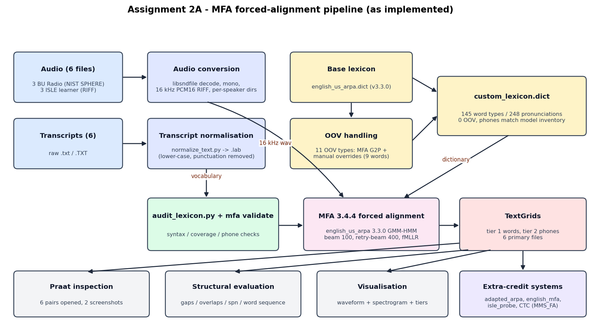
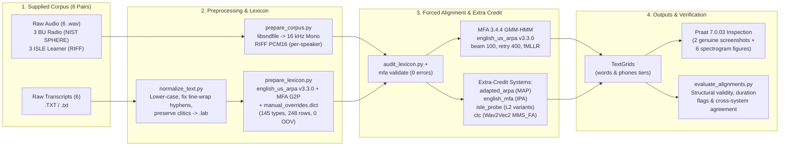
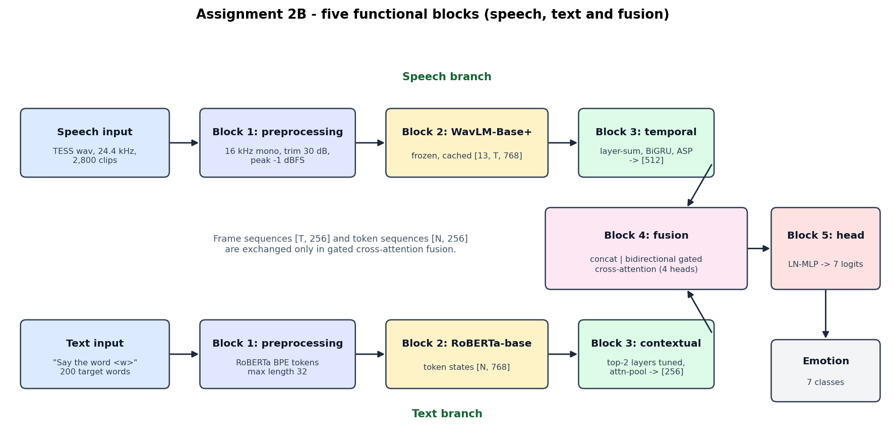
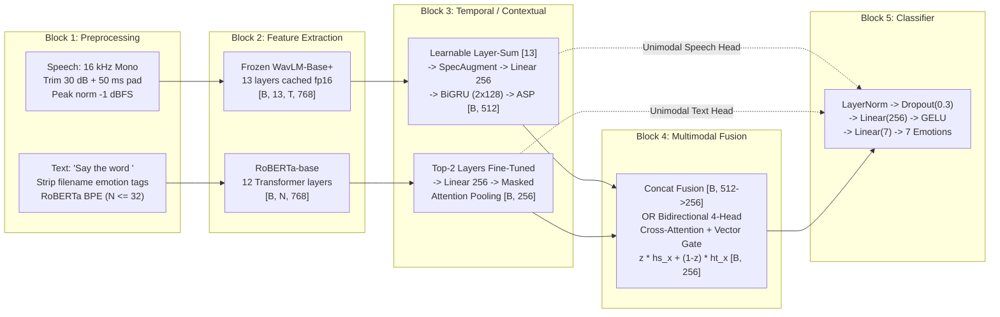

# IIITH Speech Processing Lab — Assignment 2

Comprehensive, reproducible implementations and research reports for **Assignment 2A (Forced Alignment using Montreal Forced Aligner)** and **Assignment 2B (Multimodal Emotion Recognition on TESS)**.

---

## Quick Navigation & Deliverables

| Component | Deliverable | Path / Link |
|---|---|---|
| **Assignment 2A** | Detailed Pipeline & Reproducibility Guide | [`assignment_2a_mfa/README.md`](assignment_2a_mfa/README.md) |
| **Assignment 2A** | **Final Technical Report (PDF, 10 pages)** | [`assignment_2a_mfa/report/report_2a.pdf`](assignment_2a_mfa/report/report_2a.pdf) |
| **Assignment 2A** | Generated TextGrids (Primary + 4 Extra-Credit Systems) | [`assignment_2a_mfa/outputs/textgrids/`](assignment_2a_mfa/outputs/textgrids/) |
| **Assignment 2A** | Custom ARPAbet Lexicon, G2P & Manual Overrides | [`assignment_2a_mfa/dictionaries/`](assignment_2a_mfa/dictionaries/) |
| **Assignment 2A** | Praat Screenshots, Spectrogram Plots & Evaluation Tables | [`assignment_2a_mfa/outputs/`](assignment_2a_mfa/outputs/) |
| **Assignment 2B** | Detailed Architecture & Reproducibility Guide | [`assignment_2b_emotion/README.md`](assignment_2b_emotion/README.md) |
| **Assignment 2B** | **Final Technical Report (PDF, 15 pages)** | [`assignment_2b_emotion/report/report_2b.pdf`](assignment_2b_emotion/report/report_2b.pdf) |
| **Assignment 2B** | Required `train.py` & `test.py` Pipeline Entry Points | [`assignment_2b_emotion/models/`](assignment_2b_emotion/models/) |
| **Assignment 2B** | Consolidated Accuracy Tables & Comparative Analysis | [`assignment_2b_emotion/Results/accuracy_tables.md`](assignment_2b_emotion/Results/accuracy_tables.md), [`comparative_analysis.md`](assignment_2b_emotion/Results/comparative_analysis.md) |
| **Assignment 2B** | 5 Failure Cases & 26 Evaluation / Embedding Plots | [`assignment_2b_emotion/Results/failure_cases.md`](assignment_2b_emotion/Results/failure_cases.md), [`assignment_2b_emotion/Results/plots/`](assignment_2b_emotion/Results/plots/) |

---

## Project Objectives

1. **Assignment 2A — Forced Alignment using Montreal Forced Aligner (MFA 3.4.4)**:
   - Align six heterogeneous recordings—three fast native broadcast news clips from the **Boston University Radio News Corpus (`F2B`)** and three non-native learner minimal-pair utterances from the **ISLE Corpus** (`97.163 s`, `238 words`, `1,063 phones`)—at the word and phoneme levels.
   - Resolve container incompatibilities (legacy `NIST_1A` SPHERE headers in `.wav` files), normalize transcripts, construct a zero-OOV pronunciation dictionary using **G2P + manual domain curation**, inspect boundaries in **Praat 7.0.03**, and benchmark against **MAP-adapted MFA**, **multi-dialect IPA MFA (`english_mfa`)**, an **L2 pronunciation probe**, and a **wav2vec2 MMS_FA CTC neural aligner**.

2. **Assignment 2B — Multimodal Emotion Recognition (Speech, Text & Fusion)**:
   - Design, train, and evaluate unimodal speech, unimodal text, and multimodal speech+text emotion classifiers across the five functional blocks specified in the assignment on the **Toronto Emotional Speech Set (TESS, 2,800 clips, 7 emotions, 200 target words, 2 speakers)**.
   - Prevent optimistic data-leakage bias by evaluating every model across **three frozen cross-validation protocols**: **Protocol A** (5-fold word-disjoint), **Protocol B** (2-fold unseen-speaker LOSO + word-disjoint stress test), and **Protocol C** (5-fold random stratified reference).

---

## System Architectures

### Part I: Assignment 2A — Forced Alignment Pipeline





### Part II: Assignment 2B — Five-Block Multimodal Emotion Recognition System





---

## Verified Experimental Results & Key Findings

### Assignment 2A: Forced Alignment Summary
All six primary `english_us_arpa` TextGrids achieve **100% lexical coverage** (`238/238` words, `1,063` phones, `0` gaps, `0` overlaps, `0` `spn`/OOV intervals).

| Recording | Corpus | Source Header | Duration (s) | Words Aligned | Phones | Mean / Med Phone (ms) | 30 ms Floor / >300 ms | Structural / Seq Match |
|---|---|---|---:|---:|---:|---:|---:|:---:|
| `F2BJRLP1` | BU Radio | `NIST_SPHERE` | 25.309 | 68 / 68 | 308 | 72.3 / 60.0 | 30 / 0 | Pass / Pass |
| `F2BJRLP2` | BU Radio | `NIST_SPHERE` | 28.647 | 73 / 73 | 345 | 74.7 / 70.0 | 28 / 0 | Pass / Pass |
| `F2BJRLP3` | BU Radio | `NIST_SPHERE` | 30.707 | 82 / 82 | 372 | 74.0 / 70.0 | 26 / 0 | Pass / Pass |
| `ISLE_01` | ISLE L2 | `RIFF` | 4.125 | 5 / 5 | 13 | 127.7 / 130.0 | 0 / 0 | Pass / Pass |
| `ISLE_02` | ISLE L2 | `RIFF` | 3.875 | 5 / 5 | 12 | 130.8 / 95.0 | 0 / 1 | Pass / Pass |
| `ISLE_03` | ISLE L2 | `RIFF` | 4.500 | 5 / 5 | 13 | 137.7 / 130.0 | 0 / 0 | Pass / Pass |
| **Total** | **6 Pairs** | — | **97.163** | **238 / 238** | **1,063** | — | **84 / 1** | **6/6 Valid** |

- **Cross-System Word-Boundary Agreement (vs. `english_us_arpa`, 476 boundaries)**:
  - `adapted_arpa` (MAP adaptation) & `isle_probe`: **0.08 ms mean difference** (**100.0% <= 20 ms**).
  - `english_mfa` (IPA acoustic model, 330 comparable boundaries): **30.41 ms mean**, **10.0 ms median** (**86.7% <= 20 ms**, **94.5% <= 50 ms**).
  - `ctc` (Wav2Vec2 `MMS_FA` neural word aligner): **36.69 ms mean**, **29.79 ms median** (**75.4% <= 50 ms**).

---

### Assignment 2B: Multimodal Emotion Recognition Summary
Every neural headline row below is independently recomputed from frozen test predictions in [`assignment_2b_emotion/Results/verified_p0/`](assignment_2b_emotion/Results/verified_p0/) and cryptographically bound to saved checkpoint SHA-256 digests (`verification.json`). Metrics are unweighted fold means ± population SD (`ddof=0`).

| System | Modality | Architecture | Protocol A (5-Fold Word-Disjoint) Macro-F1 (%) | Protocol B (2-Fold Unseen Speaker + Word LOSO) Macro-F1 (%) | Protocol C (5-Fold Random Stratified) Macro-F1 (%) |
|---|---|---|---:|---:|---:|
| **Speech (`S*`)** | Speech | WavLM-Base+ (13-layer sum) + BiGRU + ASP | **99.96 ± 0.07** | **56.23 ± 7.53** *(60.71% Acc)* | **99.86 ± 0.13** |
| **Text (`T*`)** | Text | RoBERTa-base (top-2 FT + masked attn pool) | 3.57 ± 0.00 *(14.29% Acc)* | 6.31 ± 0.22 *(14.29% Acc)* | 4.34 ± 0.97 *(14.25% Acc)* |
| **Concat Fusion** | Speech + Text | Pooled WavLM-ASP + RoBERTa Concat + MLP | 99.82 ± 0.11 | 34.44 ± 4.66 *(43.75% Acc)* | 99.72 ± 0.27 |
| **Gated Cross-Attn** | Speech + Text | 4-Head Bidirectional Cross-Attn + Vector Gate | 99.79 ± 0.13 | 46.40 ± 1.44 *(52.14% Acc)* | 99.82 ± 0.28 |
| *Gated Zero-Text* | *Ablation* | *Gated Fusion with text stream zeroed at test* | *90.79 ± 10.26 (91.96% Acc)* | *48.94 ± 5.68 (54.64% Acc)* | — |
| *Classical Speech* | *Speech* | *eGeMAPS (88-d) + RBF SVM (train+val fit)* | *98.43 ± 0.58* | *12.45 ± 0.71 (18.04% Acc)* | *98.55 ± 0.49* |
| *Classical Text* | *Text* | *TF-IDF (1–2 gram) + LogReg (train+val fit)* | *3.57 ± 0.00 (14.29% Acc)* | *3.57 ± 0.00 (14.29% Acc)* | *0.00 ± 0.00 (0.00% Acc)* |

### Core Research Takeaways
1. **Why Protocol Choice Governs TESS Performance (`99.96%` vs. `56.23%`)**: When both speakers appear in training (Protocols A and C), acoustic separability is near ceiling (`>=98.4%` even for an 88-feature RBF SVM), and word-disjointness (Protocol A) causes zero degradation (`99.96%` F1). Under strict unseen-speaker transfer (Protocol B), speech Macro-F1 drops to `56.23%` (`60.71%` accuracy): `fear` achieves `100.0%` recall, whereas `happy` collapses to `0.0%` recall due to cross-speaker pitch and intensity shift (`YAF` is ~6.5 dB louder than `OAF`).
2. **Why Text Is at Chance (`14.29%`) and Classical Text Protocol C Scores `0.00%`**: Every TESS carrier transcript (`"Say the word <w>"`) occurs once with each of the 7 emotions per speaker, so $P(\text{emotion} \mid \text{text}) = 1/7$ across the full dataset. Under random stratified splits without word disjointness (Protocol C), holding out one utterance of word $w$ with true label $y$ leaves $y$ under-represented in the training complement for word $w$; a memorized `TF-IDF+LR` classifier fit on `train+val` always predicts one of the 6 complement-majority labels, yielding **0.00% accuracy across all 5 folds**.
3. **Why Multimodal Fusion Cannot Beat Speech Alone on TESS**: Because TESS text carries zero mutual information with emotion labels, adding a text stream cannot contribute complementary label signal. On Protocol B, Gated Cross-Attention significantly outperforms Concatenation (`46.40%` vs. `34.44%` F1) and improves `neutral` (`+26.25 pp`) and `surprise` (`+12.50 pp`) recall, but repairs `45` utterances while harming `93` overall compared to speech alone (`56.23%` F1). Zeroing the text stream at test time on Protocol B slightly *increases* Gated Fusion accuracy from `52.14%` to `54.64%`.

---

## Repository Structure

```text
iiith-speech-a2/
├── README.md                                      # Project overview, architecture & results summary
├── requirements.txt                               # Unified Python dependencies
├── docs/figures/                                  # High-resolution block architecture diagrams
│   ├── arch_2a_pipeline.png
│   ├── arch_2b_overview.png
│   ├── arch_2b_speech.png
│   ├── arch_2b_text.png
│   └── arch_2b_fusion.png
│
├── assignment_2a_mfa/                             # Assignment 2A: MFA Forced Alignment
│   ├── README.md                                  # Complete step-by-step MFA & evaluation guide
│   ├── requirements.txt                           # Python helper dependencies for 2A
│   ├── run_pipeline.ps1                           # Automated end-to-end PowerShell runner
│   ├── configs/pipeline.yaml                      # MFA beam (100) and retry_beam (400) parameters
│   ├── dictionaries/                              # Custom ARPAbet lexicon (0 OOV), G2P & overrides
│   ├── scripts/                                   # 12 corpus prep, lexicon, alignment, CTC & plot scripts
│   ├── outputs/
│   │   ├── evaluation/                            # Validity CSV, cross-system agreement, L2 probe & Praat notes
│   │   ├── figures/                               # 6 waveform + spectrogram + TextGrid visualizations
│   │   ├── praat_screenshots/                     # 2 genuine Praat 7.0.03 editor captures (ISLE 01 & 02)
│   │   └── textgrids/                             # english_us_arpa, adapted_arpa, english_mfa, isle_probe, ctc
│   ├── report/
│   │   ├── report_2a.pdf                          # Final 10-page technical report
│   │   └── report_2a.md
│   └── tests/                                     # 9 unit tests for text normalization & lexicon auditing
│
├── assignment_2b_emotion/                         # Assignment 2B: Multimodal Emotion Recognition
│   ├── README.md                                  # Complete step-by-step TESS pipeline & ablation guide
│   ├── requirements.txt                           # Pinned Python 3.10 package versions
│   ├── requirements-lock-windows.txt              # Full Windows environment lockfile
│   ├── environment_versions.json                  # Exact runtime version manifest
│   ├── configs/                                   # speech.yaml, text.yaml, fusion_concat.yaml, fusion.yaml
│   ├── splits/                                    # Frozen Protocols A, B, C JSON split manifests
│   ├── models/                                    # Required deliverable train.py / test.py entry points
│   │   ├── speech_pipeline/                       # train.py, test.py
│   │   ├── text_pipeline/                         # train.py, test.py
│   │   └── fusion_pipeline/                       # train.py, test.py
│   ├── src/mer/                                   # Modular source package (data, features, models, training, eval)
│   ├── Results/                                   # Consolidated tables, verified_p0, per_fold & 26 plots
│   ├── report/
│   │   ├── report_2b.pdf                          # Final 15-page technical report
│   │   └── report_2b.md
│   └── tests/                                     # 10 unit tests for split leakage, models & paired stats
│
└── tools/                                         # Report generation & evaluation verification tools
    ├── build_final_reports.py                     # Generates report_2a.pdf (10 pp.) and report_2b.pdf (15 pp.)
    ├── build_reports.py                           # Read-only evidence & SHA-256 checkpoint validator
    ├── finalize_evaluation.py                     # Rebuilds consolidated tables & plots from verified_p0
    └── make_diagrams.py                           # Renders docs/figures/*.png architecture diagrams
```

---

## Environment Setup & Reproducibility

### 1. Python ML Environment (Python 3.10 + PyTorch 2.5.1 CUDA 12.1)
From the repository root in PowerShell:

```powershell
py -3.10 -m venv .venv
.\.venv\Scripts\Activate.ps1
python -m pip install --upgrade pip
python -m pip install torch==2.5.1 torchaudio==2.5.1 --index-url https://download.pytorch.org/whl/cu121
python -m pip install -r requirements.txt
```

### 2. Run the Automated Test Suite (19 Tests)
Verify transcript normalization, lexicon OOV auditing, model tensor shapes, paired significance math, and zero word/speaker leakage across Protocols A, B, and C:

```powershell
$env:PYTHONPATH = "assignment_2b_emotion/src;assignment_2a_mfa/scripts"
python -m pytest assignment_2a_mfa/tests assignment_2b_emotion/tests -q
```

### 3. Reproduce Assignment 2A & Assignment 2B
- **Assignment 2A (MFA 3.4.4)**: Follow [`assignment_2a_mfa/README.md`](assignment_2a_mfa/README.md) to run `prepare_corpus.py`, `prepare_lexicon.py`, `run_alignment.py`, `evaluate_alignments.py`, and `visualize.py`.
- **Assignment 2B (TESS Pipelines)**: Follow [`assignment_2b_emotion/README.md`](assignment_2b_emotion/README.md) to prepare TESS, extract `WavLM-Base+` and `eGeMAPS` features, and execute `models/{speech,text,fusion}_pipeline/{train,test}.py`.
- **Regenerate Diagrams & Final PDF Reports**:
  ```powershell
  python tools/make_diagrams.py
  python tools/finalize_evaluation.py
  python tools/build_final_reports.py --verification-root assignment_2b_emotion/Results/verified_p0
  ```

<details>
<summary><b>Limitations, Provenance & Licensing Notes (Click to Expand)</b></summary>

- **No Reference Phonetic Gold Boundaries (2A)**: No human-annotated ground-truth TextGrids exist for the 6 supplied BU/ISLE files; evaluation uses strict structural validity, phone duration flags, cross-model agreement, and scoped Praat visual inspection rather than claimed boundary MAE against gold.
- **Two-Speaker Acted Dataset Scope (2B)**: TESS contains only two female speakers (`OAF`, `YAF`) reading carrier phrases in studio conditions. Protocol B measures two-speaker transfer stress rather than population-level generalization.
- **Historical Text-Training Provenance Disclosure (2B)**: During initial training, a concurrent process collision wrote into shared text checkpoint folders. Invalidated legacy P0 markers are excluded; all reported metrics are derived from independent re-evaluation of the final checkpoints into `assignment_2b_emotion/Results/verified_p0/` with SHA-256 verification records.
- **Licensing & Git Hygiene**: Raw/licensed audio (BU Radio, ISLE, TESS; Borealis DOI `10.5683/SP2/E8H2MF`, CC BY-NC 4.0), cached feature tensors (`.pt`, `.npy`), and large model weights are excluded from Git via [`.gitignore`](.gitignore).
</details>

---

## References

1. M. McAuliffe, M. Socolof, S. Mihuc, M. Wagner, and M. Sonderegger, "Montreal Forced Aligner: Trainable Text-Speech Alignment Using Kaldi," *Interspeech*, 2017.
2. V. Pratap et al., "Scaling Speech Technology to 1,000+ Languages (MMS)," *arXiv:2305.13516*, 2023.
3. A. Rousso et al., "Tradition or Innovation: A Comparison of Modern ASR Methods for Forced Alignment," *Interspeech*, 2024.
4. M. K. Pichora-Fuller and K. Dupuis, "Toronto Emotional Speech Set (TESS)," *Borealis Dataverse*, 2020, `doi:10.5683/SP2/E8H2MF`.
5. S. Chen et al., "WavLM: Large-Scale Self-Supervised Pre-Training for Full Stack Speech Processing," *IEEE JSTSP*, 2022.
6. K. Okabe, T. Koshinaka, and K. Shinoda, "Attentive Statistics Pooling for Deep Speaker Embedding," *Interspeech*, 2018.
7. Y. Liu et al., "RoBERTa: A Robustly Optimized BERT Pretraining Approach," *arXiv:1907.11692*, 2019.
8. Y.-H. H. Tsai et al., "Multimodal Transformer for Unaligned Multimodal Language Sequences," *ACL*, 2019.
9. J. Arevalo et al., "Gated Multimodal Units for Information Fusion," *ICLR Workshop*, 2017.
