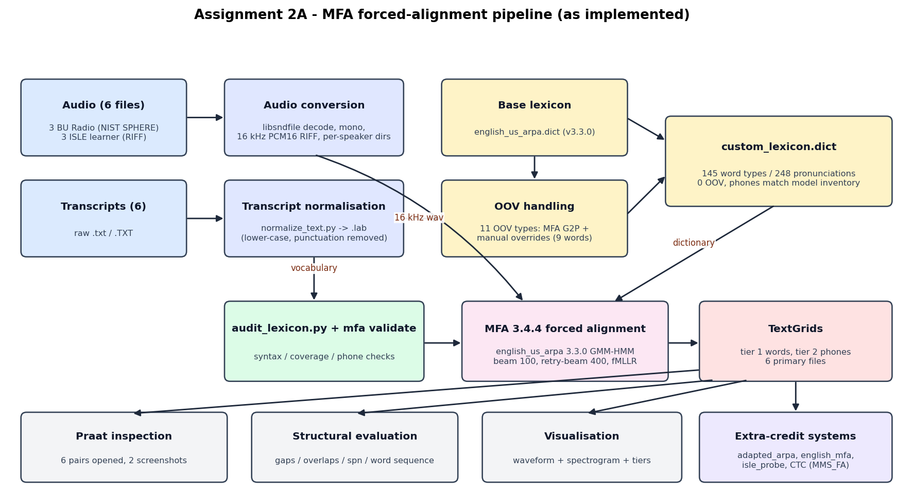
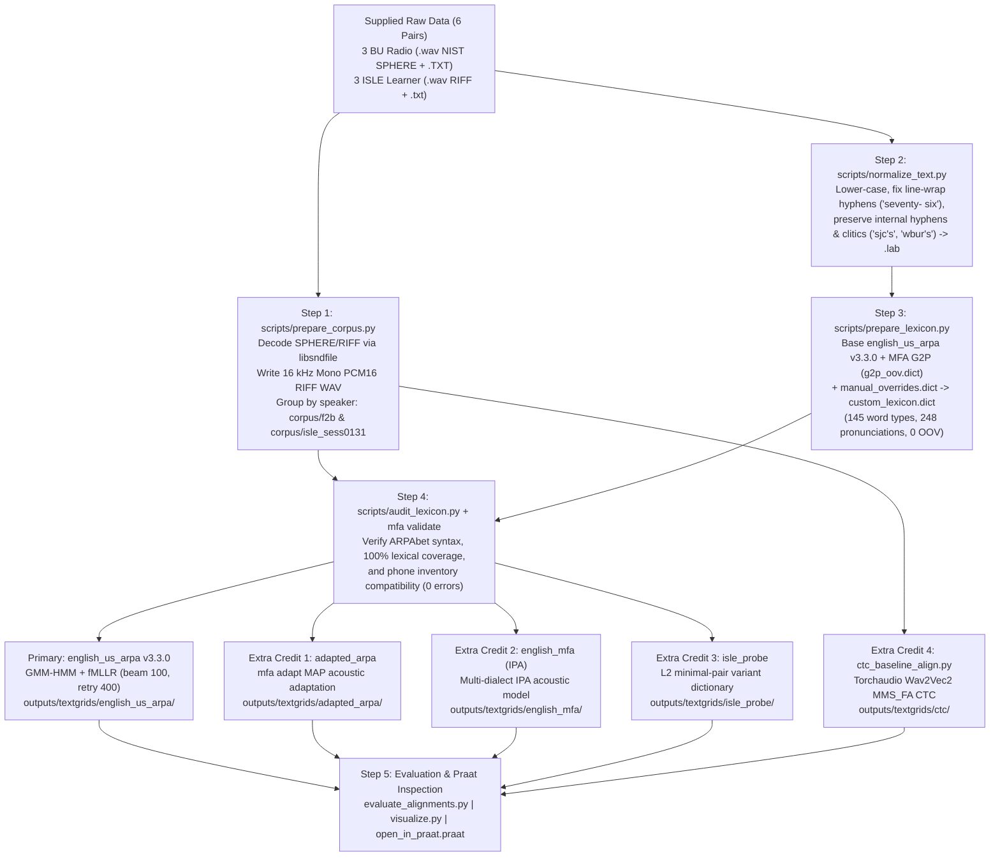
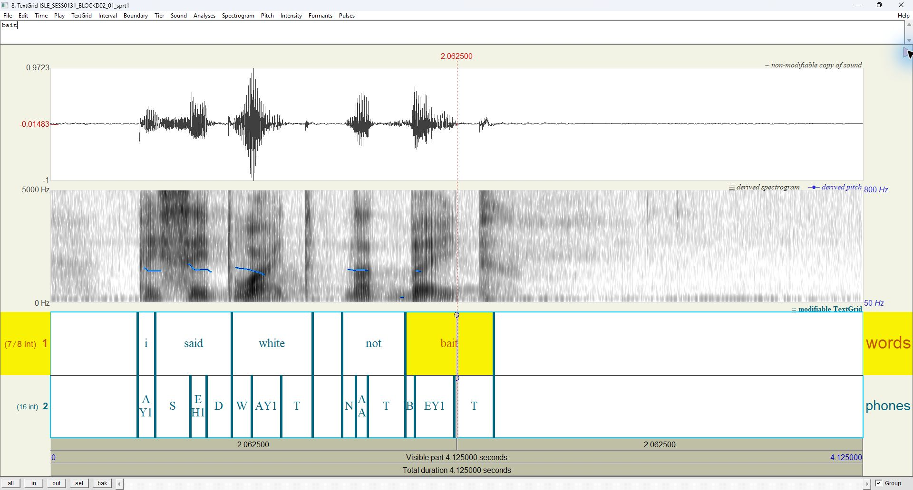

# Assignment 2A: Forced Alignment Using Montreal Forced Aligner (MFA)

Complete, reproducible forced-alignment pipeline for **Assignment 2A**, aligning speech audio with orthographic transcripts at the word and phoneme levels using **Montreal Forced Aligner (MFA 3.4.4)** and benchmarking against four extra-credit alignment configurations.

- **Final Technical Report (PDF, 10 pages)**: [`report/report_2a.pdf`](report/report_2a.pdf)
- **Generated TextGrids (5 Systems × 6 Files = 30 TextGrids)**: [`outputs/textgrids/`](outputs/textgrids/)
- **Evaluation Tables & Praat Inspection Notes**: [`outputs/evaluation/summary.md`](outputs/evaluation/summary.md), [`outputs/evaluation/praat_observations.md`](outputs/evaluation/praat_observations.md)
- **Spectrogram + Alignment Figures & Genuine Praat Captures**: [`outputs/figures/`](outputs/figures/), [`outputs/praat_screenshots/`](outputs/praat_screenshots/)

---

## 1. Pipeline Architecture





---

## 2. Dataset & Preprocessing (`prepare_corpus.py`, `normalize_text.py`)

Only the six assignment-supplied recordings are used (`97.163 s` total duration, `238` word tokens, `145` unique word types). Raw/licensed audio is excluded from Git tracking via `.gitignore`.

| Recording | Collection | Speaker Dir | Raw Container | Rate / Channels | Duration (s) | Words | Peak |
|---|---|---|---|---|---:|---:|---:|
| `F2BJRLP1` | BU Radio News | `corpus/f2b` | `NIST_SPHERE` (`NIST_1A`) | 16 kHz / Mono PCM16 | 25.309 | 68 | 0.267 |
| `F2BJRLP2` | BU Radio News | `corpus/f2b` | `NIST_SPHERE` (`NIST_1A`) | 16 kHz / Mono PCM16 | 28.647 | 73 | 0.260 |
| `F2BJRLP3` | BU Radio News | `corpus/f2b` | `NIST_SPHERE` (`NIST_1A`) | 16 kHz / Mono PCM16 | 30.707 | 82 | 0.314 |
| `ISLE_SESS0131_BLOCKD02_01_sprt1` | ISLE L2 Learner | `corpus/isle_sess0131` | `RIFF` (with PAD chunk) | 16 kHz / Mono PCM16 | 4.125 | 5 | 1.000 |
| `ISLE_SESS0131_BLOCKD02_02_sprt1` | ISLE L2 Learner | `corpus/isle_sess0131` | `RIFF` (with PAD chunk) | 16 kHz / Mono PCM16 | 3.875 | 5 | 1.000 |
| `ISLE_SESS0131_BLOCKD02_03_sprt1` | ISLE L2 Learner | `corpus/isle_sess0131` | `RIFF` (with PAD chunk) | 16 kHz / Mono PCM16 | 4.500 | 5 | 1.000 |

### Critical Preprocessing Details
1. **NIST SPHERE Transcoding**: Although named `.wav`, `F2BJRLP1–3` carry `NIST_1A` SPHERE headers that crash standard RIFF parsers and Kaldi/Praat if not converted. [`scripts/prepare_corpus.py`](scripts/prepare_corpus.py) decodes all files with `libsndfile`, verifies 16 kHz mono, and writes standard 16-bit PCM RIFF WAVs into speaker-grouped folders (`corpus/f2b/` and `corpus/isle_sess0131/`) so MFA can compute per-speaker fMLLR transforms.
2. **Linguistically Faithful Transcript Normalization**: [`scripts/normalize_text.py`](scripts/normalize_text.py) lower-cases text, strips punctuation, repairs line-wrap broken hyphens (`"seventy- six"` → `"seventy six"`), preserves internal compound hyphens (`"de-politicize"`), and collapses dotted initialisms while retaining possessives (`"S.J.C.'s"` → `"sjc's"`, `"WBUR's"` → `"wbur's"`). This avoids splitting possessives into spurious standalone `"s"` word tokens.

---

## 3. Pronunciation Dictionary & OOV Resolution (`dictionaries/`)

Auditing the 145 corpus word types against the stock `english_us_arpa` v3.3.0 dictionary identified **11 base OOV word types** (`de-politicize`, `dukakis`, `hennessy`, `hennessy's`, `judgeships`, `maffy`, `mandatory`, `margo`, `melnicove`, `sjc's`, `wbur's`).

1. **G2P Generation**: MFA's pretrained WFST G2P model (`english_us_arpa` v3.3.0) generated initial candidates in [`dictionaries/g2p_oov.dict`](dictionaries/g2p_oov.dict).
2. **Manual Curation for Initialisms & Proper Names**: Because G2P treats initialisms as single orthographic words (e.g., predicting `B ER0 Z` for `wbur's`), [`dictionaries/manual_overrides.dict`](dictionaries/manual_overrides.dict) supplies letter-by-letter broadcast pronunciations and stress-verified proper-noun variants:

| OOV Word | G2P Candidate(s) | Curated Pronunciation(s) in `custom_lexicon.dict` | Linguistic Rationale |
|---|---|---|---|
| `sjc's` | `S JH K S; S ZH K S` | `EH1 S JH EY1 S IY1 Z` | Spelled-out initialism (*S-J-C*) + possessive `/z/` |
| `wbur's` | `B ER0 Z; W B ER0 Z` | `D AH1 B AH0 L Y UW0 B IY1 Y UW1 AA1 R Z` | Broadcast call sign (*W-B-U-R*) + possessive `/z/` |
| `dukakis` | `D UW1 K AA1 K IH0 S` | `D UW0 K AA1 K IH0 S; D AH0 K AA1 K IH0 S` | Unstressed initial syllable variants |
| `melnicove` | `M EH1 L N IH0 K OW2 V` | `M EH1 L N IH0 K OW2 V; M EH1 L N AH0 K OW2 V` | Broadcast reporter surname variants |
| `maffy` | `M AE1 F IY0` | `M AE1 F IY0` | G2P candidate verified |
| `hennessy('s)` | `HH EH1 N AH0 S IY0 (Z)` | `HH EH1 N AH0 S IY0 (Z)` | Chief Justice surname + possessive |
| `de-politicize` | `D EH2 P AH0 L IH1 T AH0 S AY2 Z` | `D IY2 P AH0 L IH1 T AH0 S AY2 Z; D IH0 P ...` | Hyphenated verb prefix variants |
| `judgeships` | `JH AH1 JH SH IH2 P S` | `JH AH1 JH SH IH2 P S` | Compound plural noun |

3. **Lexicon Audit**: [`scripts/audit_lexicon.py`](scripts/audit_lexicon.py) verifies that [`dictionaries/custom_lexicon.dict`](dictionaries/custom_lexicon.dict) covers all 145 corpus word types (`248` pronunciation rows: `234` base, `12` manual, `2` G2P) with **0 OOVs** and 100% phone compatibility with the `english_us_arpa` acoustic inventory ([`outputs/evaluation/lexicon_audit.json`](outputs/evaluation/lexicon_audit.json)).

---

## 4. Forced Alignment & Extra-Credit Systems

We executed five distinct alignment configurations across the 6 recordings:

1. **Primary Benchmark (`english_us_arpa`)**: Pretrained General American GMM-HMM model (`v3.3.0`, trained on 289,667 utterances / 2,445 speakers) with 13 MFCCs + $\Delta + \Delta\Delta$, CMVN, LDA, and per-speaker **fMLLR** adaptation, decoded with `--beam 100 --retry_beam 400` ([`configs/pipeline.yaml`](configs/pipeline.yaml)). Outputs: [`outputs/textgrids/english_us_arpa/`](outputs/textgrids/english_us_arpa/).
2. **MAP Acoustic Model Adaptation (`adapted_arpa`, Extra Credit)**: Adapts the GMM means to the target corpus via `mfa adapt` before alignment. Outputs: [`outputs/textgrids/adapted_arpa/`](outputs/textgrids/adapted_arpa/).
3. **Multi-Dialect IPA Model (`english_mfa`, Extra Credit)**: Aligns using MFA's global English IPA model. Because the stock IPA dictionary was used without our custom ARPAbet initialism overrides, `F2BJRLP2` exhibits a 74- vs. 73-word tokenization mismatch and 9 `spn` intervals across the BU files. Outputs: [`outputs/textgrids/english_mfa/`](outputs/textgrids/english_mfa/).
4. **ISLE L2 Minimal-Pair Pronunciation Probe (`isle_probe`, Extra Credit)**: [`scripts/l2_pronunciation_probe.py`](scripts/l2_pronunciation_probe.py) constructs [`dictionaries/isle_probe.dict`](dictionaries/isle_probe.dict) containing both canonical and L1-confusable phone sequences for the 6 target contrast words (`white/bait`, `new/no`, `bad/bed`). Viterbi decoding selects `N Y UW1` (yod insertion) for `new` in `ISLE_02` and `B EH1 T` (vowel raising + final stop devoicing) for `bad` in `ISLE_03` ([`outputs/evaluation/l2_probe.md`](outputs/evaluation/l2_probe.md)).
5. **Neural End-to-End CTC Aligner (`ctc`, Extra Credit)**: [`scripts/ctc_baseline_align.py`](scripts/ctc_baseline_align.py) uses `torchaudio.pipelines.MMS_FA` (Wav2Vec2 CTC forced alignment) to produce word-level TextGrids ([`outputs/textgrids/ctc/`](outputs/textgrids/ctc/)).

### Sample Generated TextGrid (`ISLE_SESS0131_BLOCKD02_01_sprt1.TextGrid`)
Utterance: `"i said white not bait"` (`4.125 s`, 5 words, 13 phones):
- **Words tier**: `[0.00–0.44 ""]`, `[0.44–0.53 "i"]`, `[0.53–0.92 "said"]`, `[0.92–1.33 "white"]`, `[1.33–1.48 ""]`, `[1.48–1.80 "not"]`, `[1.80–2.25 "bait"]`, `[2.25–4.125 ""]`
- **Phones tier**: `AY1 (90 ms) | S (180 ms) | EH1 (80 ms) | D (130 ms) | W (100 ms) | AY1 (150 ms) | T (160 ms) | sil (150 ms) | N (70 ms) | AA1 (60 ms) | T (190 ms) | B (50 ms) | EY1 (200 ms) | T (200 ms)`

---

## 5. Praat Inspection, Visualizations & Results

### Genuine Praat 7.0.03 Visual Inspection
All six primary audio/TextGrid pairs were opened in Praat 7.0.03 via [`scripts/open_in_praat.praat`](scripts/open_in_praat.praat). Full observations are documented in [`outputs/evaluation/praat_observations.md`](outputs/evaluation/praat_observations.md):
- **ISLE 01–03**: Inter-word pauses (e.g., `1.33–1.48 s` between `white` and `not` in `ISLE_01`) and long trailing silences are cleanly segmented into blank intervals. In `ISLE_02`, the `350 ms` `OW1` vowel in `no` (`1.870–2.220 s`) absorbs the falling voiced decay tail.
- **BU Radio (`F2BJRLP1–3`)**: Rapid broadcast speech averages `72.3–74.7 ms` per phone (vs. `127.7–137.7 ms` in ISLE), with `84` function-word/consonant intervals hitting the `30 ms` 3-state HMM floor. Curated proper nouns (`dukakis`, `hennessy`, `melnicove`, `maffy`) and initialisms (`sjc's`, `wbur's`) align smoothly onto their full phoneme sequences.

| Genuine Praat Editor Capture (`ISLE_01`) | Spectrogram + Tier Plot (`F2BJRLP1` Excerpt) |
|---|---|
|  |  |

---

## 6. Step-by-Step Reproducibility Commands

Run commands from `assignment_2a_mfa/`:

```powershell
# 1. Create and activate the MFA 3.4.4 environment (Conda or Micromamba)
conda create -n mfa -c conda-forge montreal-forced-aligner=3.4.4 -y
conda activate mfa
mfa model download acoustic english_us_arpa
mfa model download dictionary english_us_arpa

# 2. Prepare the 6 audio/transcript pairs (NIST SPHERE -> 16 kHz RIFF WAV + .lab)
python scripts/prepare_corpus.py --raw "D:\path\to\provided_2a" --out corpus
python -m pytest tests -q

# 3. Package pinned official ARPA v3.3.0 snapshot & build custom zero-OOV lexicon
python scripts/prepare_models.py
python scripts/prepare_lexicon.py
python scripts/audit_lexicon.py --dictionary dictionaries/custom_lexicon.dict --corpus corpus --out outputs/evaluation/lexicon_audit.json

# 4. Validate and run MFA forced alignment (or use scripts/run_alignment.py)
mfa validate corpus dictionaries/custom_lexicon.dict english_us_arpa
mfa align corpus dictionaries/custom_lexicon.dict english_us_arpa outputs/textgrids/english_us_arpa --config_path configs/pipeline.yaml

# 5. Run extra-credit CTC baseline, L2 probe, quantitative evaluation & plots
python scripts/ctc_baseline_align.py --corpus corpus --out outputs/textgrids/ctc
python scripts/l2_pronunciation_probe.py --mode analyze --tg_dir outputs/textgrids/isle_probe --out_md outputs/evaluation/l2_probe.md
python scripts/evaluate_alignments.py --corpus corpus --tg_root outputs/textgrids --gold gold --out outputs/evaluation
python scripts/visualize.py --corpus corpus --tg_dir outputs/textgrids/english_us_arpa --out outputs/figures
```
