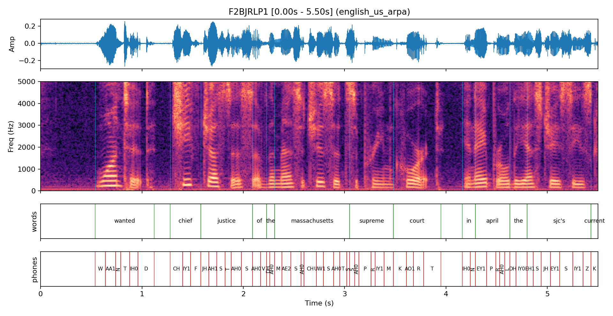
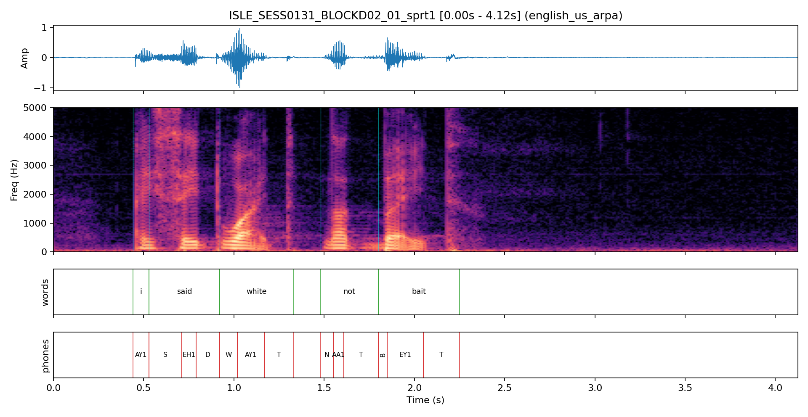
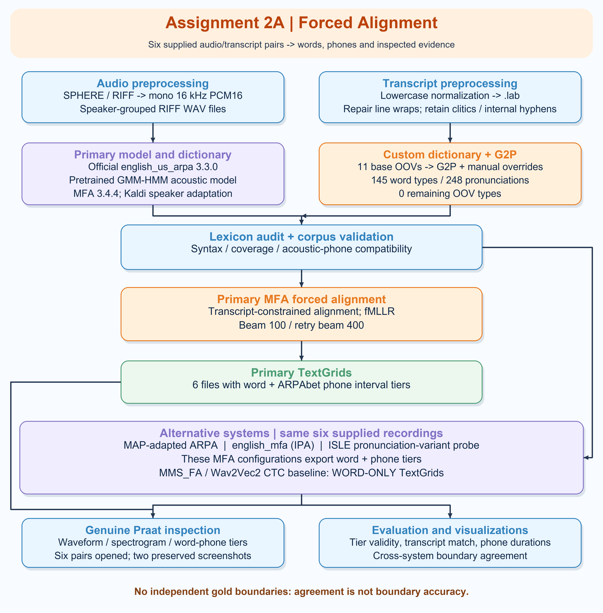
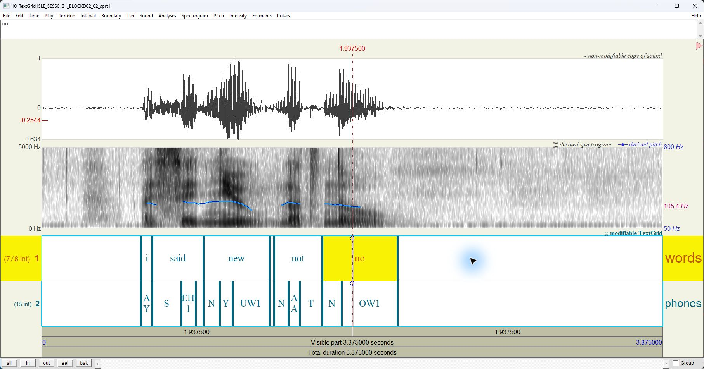

| Quick navigation | Links |
|---|---|
| Reports | [2A final PDF · 10 pages](report/report_2a.pdf) · [Combined report](../Combined_Report.pdf) · [Project overview](../README.md) |
| Evidence | [Results](outputs/evaluation/summary.md) · [TextGrids](outputs/textgrids/) · [Praat observations](outputs/evaluation/praat_observations.md) |
| Read in order | [Results and graphs](#main-alignment-results-and-visualizations) / [Architecture](#architecture-and-technical-design) / [Preparation](#audio-and-transcript-preparation) / [Experiments](#mfa-acoustic-alignment-and-five-evaluated-configurations) / [Requirements](#official-requirements-and-evidence) |
| Reproduce | [Architecture](#architecture-and-technical-design) · [Installation and execution](#installation-and-execution) · [Source and references](#source-outputs-tests-and-references) |

# Assignment 2A · Forced alignment

The 10-page report opens with results and alignment plots, then covers architecture, methodology, TextGrid examples, genuine Praat inspection and limitations. Its contents and PDF bookmarks are clickable.

## Main alignment results and visualizations

Six recordings total 97.163 seconds. All 145 corpus word types are covered by the custom dictionary (248 pronunciations); 11 base-dictionary OOVs are resolved.

| Configuration | TextGrids | Exact transcript matches | Phone tiers |
|---|---:|---:|---|
| Primary english_us_arpa | 6 | 6/6 | Yes |
| Adapted ARPA | 6 | 6/6 | Yes |
| Multi-dialect english_mfa | 6 | 5/6 | Yes; one transcript mismatch |
| CTC comparator | 6 | 6/6 | No, word-only |
| ISLE pronunciation probe | 6 | 6/6 | Yes |





[All six plots](outputs/figures/) · [Validity and duration measurements](outputs/evaluation/validity_and_durations.csv).

## Architecture and technical design



The implementation decodes SPHERE/RIFF audio to 16 kHz mono PCM16, groups speakers, normalizes transcripts, constructs an audited G2P-backed lexicon and runs MFA GMM-HMM alignment with speaker adaptation. Word/phone tiers feed structural checks, cross-system comparisons and Praat inspection.

The corrected architecture uses **lowercase** normalization and explicitly labels CTC as **word-only**. The five configurations share evaluation machinery but do not all share a phone inventory or acoustic model. [Detailed executable schematic](../docs/figures/arch_2a_pipeline.png).

## Audio and transcript preparation

Only the six assignment-supplied recordings are used (`97.163 s` total duration, `238` word tokens, `145` unique word types). Raw/licensed audio is excluded from Git tracking via `.gitignore`.

| Recording | Collection | Speaker Dir | Raw Container | Rate / Channels | Duration (s) | Words | Peak |
|---|---|---|---|---|---:|---:|---:|
| `F2BJRLP1` | BU Radio News | `corpus/f2b` | `NIST_SPHERE` (`NIST_1A`) | 16 kHz / Mono PCM16 | 25.309 | 68 | 0.267 |
| `F2BJRLP2` | BU Radio News | `corpus/f2b` | `NIST_SPHERE` (`NIST_1A`) | 16 kHz / Mono PCM16 | 28.647 | 73 | 0.260 |
| `F2BJRLP3` | BU Radio News | `corpus/f2b` | `NIST_SPHERE` (`NIST_1A`) | 16 kHz / Mono PCM16 | 30.707 | 82 | 0.314 |
| `ISLE_SESS0131_BLOCKD02_01_sprt1` | ISLE L2 Learner | `corpus/isle_sess0131` | `RIFF` (with PAD chunk) | 16 kHz / Mono PCM16 | 4.125 | 5 | 1.000 |
| `ISLE_SESS0131_BLOCKD02_02_sprt1` | ISLE L2 Learner | `corpus/isle_sess0131` | `RIFF` (with PAD chunk) | 16 kHz / Mono PCM16 | 3.875 | 5 | 1.000 |
| `ISLE_SESS0131_BLOCKD02_03_sprt1` | ISLE L2 Learner | `corpus/isle_sess0131` | `RIFF` (with PAD chunk) | 16 kHz / Mono PCM16 | 4.500 | 5 | 1.000 |

### Critical Preprocessing Details
1. **NIST SPHERE Transcoding**: Although named `.wav`, `F2BJRLP1–3` carry `NIST_1A` SPHERE headers that crash standard RIFF parsers and Kaldi/Praat if not converted. [`scripts/prepare_corpus.py`](scripts/prepare_corpus.py) decodes all files with `libsndfile`, verifies 16 kHz mono, and writes standard 16-bit PCM RIFF WAVs into speaker-grouped folders (`corpus/f2b/` and `corpus/isle_sess0131/`) so MFA can compute per-speaker fMLLR transforms.
2. **Linguistically Faithful Transcript Normalization**: [`scripts/normalize_text.py`](scripts/normalize_text.py) lower-cases text, strips punctuation, repairs line-wrap broken hyphens (`"seventy- six"` → `"seventy six"`), preserves internal compound hyphens (`"de-politicize"`), and collapses dotted initialisms while retaining possessives (`"S.J.C.'s"` → `"sjc's"`, `"WBUR's"` → `"wbur's"`). This avoids splitting possessives into spurious standalone `"s"` word tokens.

## Dictionary construction, G2P and OOV handling

Auditing the 145 corpus word types against the stock `english_us_arpa` v3.3.0 dictionary identified **11 base OOV word types** (`de-politicize`, `dukakis`, `hennessy`, `hennessy's`, `judgeships`, `maffy`, `mandatory`, `margo`, `melnicove`, `sjc's`, `wbur's`).

1. **G2P Generation**: MFA's pretrained WFST G2P model (`english_us_arpa` v3.3.0) generated initial candidates in [`dictionaries/g2p_oov.dict`](dictionaries/g2p_oov.dict).
2. **Manual Curation for Initialisms & Proper Names**: Because G2P treats initialisms as single orthographic words (e.g., predicting `B ER0 Z` for `wbur's`), [`dictionaries/manual_overrides.dict`](dictionaries/manual_overrides.dict) supplies letter-by-letter broadcast pronunciations and stress-verified proper-noun variants:

| OOV Word | G2P Candidate(s) | Curated Pronunciation(s) in `custom_lexicon.dict` | Linguistic Rationale |
|---|---|---|---|
| `sjc's` | `S JH K S; S ZH K S` | `EH1 S JH EY1 S IY1 Z` | Spelled-out initialism (*S-J-C*) + possessive `/z/` |
| `wbur's` | `B ER0 Z; W B ER0 Z` | `D AH1 B AH0 L Y UW0 B IY1 Y UW1 AA1 R Z` | Broadcast call sign (*W-B-U-R*) + possessive `/z/` |
| `dukakis` | `D UW1 K AA1 K IH0 S` | `D UW0 K AA1 K IH0 S; D AH0 K AA1 K IH0 S` | Unstressed initial syllable variants |
| `melnicove` | `M EH1 L N IH0 K OW2 V` | `M EH1 L N IH0 K OW2 V; M EH1 L N AH0 K OW2 V` | Broadcast reporter surname variants |
| `maffy` | `M AE1 F IY0` | `M AE1 F IY0` | G2P candidate verified |
| `hennessy('s)` | `HH EH1 N AH0 S IY0 (Z)` | `HH EH1 N AH0 S IY0 (Z)` | Chief Justice surname + possessive |
| `de-politicize` | `D EH2 P AH0 L IH1 T AH0 S AY2 Z` | `D IY2 P AH0 L IH1 T AH0 S AY2 Z; D IH0 P ...` | Hyphenated verb prefix variants |
| `judgeships` | `JH AH1 JH SH IH2 P S` | `JH AH1 JH SH IH2 P S` | Compound plural noun |

3. **Lexicon Audit**: [`scripts/audit_lexicon.py`](scripts/audit_lexicon.py) verifies that [`dictionaries/custom_lexicon.dict`](dictionaries/custom_lexicon.dict) covers all 145 corpus word types (`248` pronunciation rows: `234` base, `12` manual, `2` G2P) with **0 OOVs** and 100% phone compatibility with the `english_us_arpa` acoustic inventory ([`outputs/evaluation/lexicon_audit.json`](outputs/evaluation/lexicon_audit.json)).

## MFA acoustic alignment and five evaluated configurations

MFA 3.4.4 uses the pinned official ARPA 3.3.0 model for the primary system, with beam 100 and retry beam 400. Speaker directories support fMLLR estimation. Configuration and model identities are recorded in [pipeline configuration](configs/pipeline.yaml) and [model provenance](outputs/evaluation/model_provenance.json).

| Configuration | Method and outputs |
|---|---|
| [english_us_arpa](outputs/textgrids/english_us_arpa/) | Primary ARPAbet acoustic model and custom dictionary |
| [adapted_arpa](outputs/textgrids/adapted_arpa/) | MAP acoustic adaptation of the ARPA model |
| [english_mfa](outputs/textgrids/english_mfa/) | Multi-dialect IPA alternative; F2BJRLP2 transcript mismatch and 9 spn intervals limit comparison |
| [ctc](outputs/textgrids/ctc/) | Torchaudio MMS_FA Wav2Vec2 CTC word alignment |
| [isle_probe](outputs/textgrids/isle_probe/) | Canonical and alternative pronunciations for learner contrasts |

## Generated TextGrids and genuine Praat inspection

[All 30 TextGrids](outputs/textgrids/) retain their configuration directories. Open primary audio and TextGrids with [the Praat script](scripts/open_in_praat.praat). Audio must be restored locally.




Praat 7.0.03 inspection covers all six opened primary pairs, full ISLE utterances and detailed BU excerpts of approximately 5.5 seconds. [Inspection scope and observations](outputs/evaluation/praat_observations.md) distinguish visual evidence from inference. No listening-based gold annotation or manual boundary edits are claimed.

## Alignment analysis, pronunciation observations and limitations

Cross-system word-boundary agreement uses primary ARPA as the reference:

| Alternative | Matched boundaries | Mean absolute difference (ms) | Within 50 ms (%) |
|---|---:|---:|---:|
| Adapted ARPA | 476 | 0.08 | 100.0 |
| CTC | 476 | 36.69 | 75.4 |
| english_mfa | 330 | 30.41 | 94.5 |
| ISLE probe | 476 | 0.08 | 100.0 |

[Full agreement CSV](outputs/evaluation/cross_system_agreement.csv). Reduced IPA coverage excludes the mismatched utterance. These are agreement measurements, not gold-boundary accuracy; no independent boundary MAE is available. Small adaptation differences cannot establish improvement on six clips.

The ISLE `no` vowel OW1 spans 1.870-2.220 s, including a decaying tail; its endpoint is uncertain. Alternative-dictionary decoding selects `N Y UW1` for `new` and `B EH1 T` for `bad`. These are model-selected pronunciation hypotheses, not verified learner errors or phonetic diagnoses. [Pronunciation probe](outputs/evaluation/l2_probe.md) · [Inspection observations](outputs/evaluation/praat_observations.md).

## Installation and execution

Use a separate reproduction workspace and restore the six licensed audio/transcript pairs. Commands below document reproduction; existing verified outputs should be preserved.

<details>
<summary>Environment and primary pipeline commands</summary>

```powershell
# Repository root: Python environment and project dependencies
py -3.10 -m venv .venv
./.venv/Scripts/Activate.ps1
python -m pip install -r requirements.txt

# Install MFA separately. The project Python runs the guarded orchestrator.
conda create -n mfa -c conda-forge montreal-forced-aligner=3.4.4 -y
conda activate mfa

# From assignment_2a_mfa, after restoring licensed inputs
../.venv/Scripts/python.exe scripts/run_alignment.py --raw "D:/path/to/provided_2a"
# The runner packages pinned official models, generates G2P candidates,
# builds/audits the custom dictionary, validates, and aligns the primary system.
../.venv/Scripts/python.exe scripts/evaluate_alignments.py --corpus corpus --tg_root outputs/textgrids --gold gold --out outputs/evaluation
../.venv/Scripts/python.exe scripts/visualize.py --corpus corpus --tg_dir outputs/textgrids/english_us_arpa --out outputs/figures
../.venv/Scripts/python.exe -m pytest tests -q -p no:cacheprovider
```

For Micromamba installations and environment/root options, inspect `python scripts/run_alignment.py --help` for MFA environment/root options. The [full configuration runner](run_pipeline.ps1) includes cleaning/overwrite operations and should run only in a separate reproduction workspace, not over preserved results.

</details>

## Official requirements and evidence

The supplied 2A brief requests the provided audio/transcript pairs only, MFA setup, a pronunciation dictionary, word/phone alignment, Praat inspection and a short report. Multiple acoustic models and automation are extra credit.

| Official requirement | Existing implementation or evidence |
|---|---|
| Install MFA and prepare its corpus format | [Environment and commands](#installation-and-execution), [corpus preparation](scripts/prepare_corpus.py) |
| Use only supplied recordings and transcripts | [Six-recording inventory](#audio-and-transcript-preparation), [normalization tests](tests/test_normalize.py) |
| Select dictionary; handle missing pronunciations | [G2P and curated lexicon](#dictionary-construction-g2p-and-oov-handling), [coverage audit](outputs/evaluation/lexicon_audit.json) |
| Align word and phoneme boundaries | [Primary MFA TextGrids](outputs/textgrids/english_us_arpa/), [validity checks](outputs/evaluation/validity_and_durations.csv) |
| Inspect TextGrids in Praat; identify offsets/mismatches | [Genuine captures](outputs/praat_screenshots/), [observations and inspection scope](outputs/evaluation/praat_observations.md), [alignment analysis](#alignment-analysis-pronunciation-observations-and-limitations) |
| Report model/dictionary, example visualization and observations | [Existing individual report](report/report_2a.pdf), [combined report](../Combined_Report.pdf) |
| Public scripts, setup instructions and outputs | [Scripts](scripts/), [commands](#installation-and-execution), [outputs](outputs/) |
| Extra credit: multiple models and automation | [Five configurations](#mfa-acoustic-alignment-and-five-evaluated-configurations), [guarded orchestrator](scripts/run_alignment.py) |

The brief's separate email/report submission is an owner action; repository documentation does not claim submission. Licensed source audio is restored locally for reproduction, rather than redistributed here. The CTC comparator is supplementary and does not replace the primary MFA phone tiers.

## Source, outputs, tests and references

- Preparation: [audio/transcripts](scripts/prepare_corpus.py), [normalization](scripts/normalize_text.py), [model packaging](scripts/prepare_models.py).
- Lexicon: [construction](scripts/prepare_lexicon.py), [audit](scripts/audit_lexicon.py), [dictionaries](dictionaries/), [OOV evidence](outputs/evaluation/oov_report.md).
- Alignment: [guarded runner](scripts/run_alignment.py), [CTC](scripts/ctc_baseline_align.py), [pronunciation probe](scripts/l2_pronunciation_probe.py).
- Evaluation: [analysis](scripts/evaluate_alignments.py), [visualization](scripts/visualize.py), [tests](tests/), [outputs](outputs/).
- [MFA paper](https://www.isca-archive.org/interspeech_2017/mcauliffe17_interspeech.html) · [MFA documentation](https://montreal-forced-aligner.readthedocs.io/) · [Praat](https://www.fon.hum.uva.nl/praat/).
