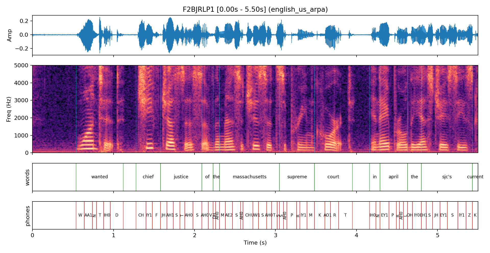
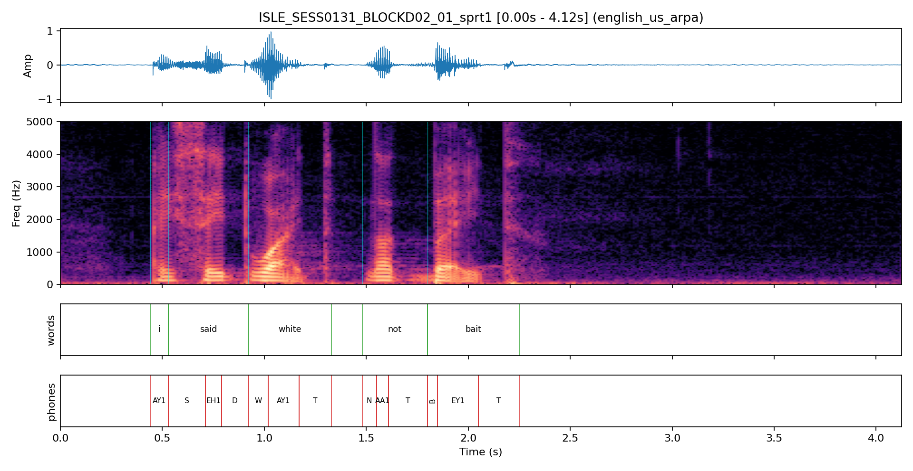
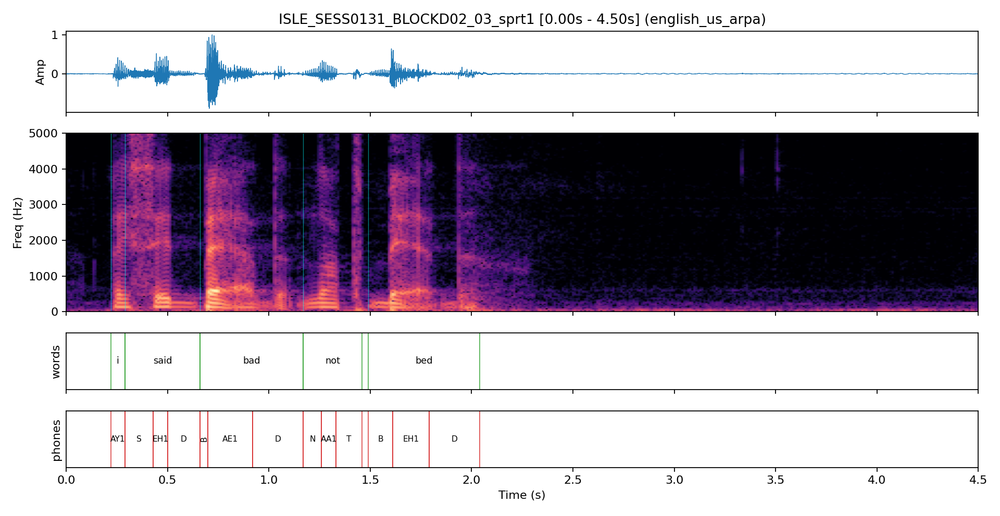

# Assignment 2A | Forced alignment

**DRAFT - pending evidence remains.**

## Method and structural evidence

Only the six provided BU/ISLE recordings were used. BU files have NIST SPHERE headers despite .wav names; preparation decodes and writes RIFF PCM16 at 16 kHz mono, normalizes transcripts into .lab and groups speakers. No outside 2A audio or gold alignments are used.

MFA 3.4.4; official MontrealCorpusTools English US ARPA archive 3.3.0; pinned Hugging Face revision 9c8d5d8e1dd5d9cf188a5571203de0e09ca6bede. Tool-observed MFA validation completed successfully (exit 0). work/validate_arpa/corpus/corpus.log records 97.163 s total audio duration and 258.858 s full validation runtime. These are execution facts, not user attestation or listening-based boundary evaluation. The validator trained a small monophone diagnostic; this is distinct from the primary pretrained alignment model. Kaldi GMM-HMM alignment estimates transcript-constrained word/phone times [A1].

Lexicon: 145 corpus word types; 248 pronunciation rows; 11 base OOV types covered by G2P/manual candidates; 0 final OOV types. Acoustic inventory compatible: True. Source-row counts {'base': 234, 'manual': 12, 'g2p': 2}. Candidate pronunciations are not human gold.

| Recording | Seconds | Words | Phones | Valid / seq. |
|---|---|---|---|---|
| F2BJRLP1 | 25.309 | 68 | 308 | True / True |
| F2BJRLP2 | 28.647 | 73 | 345 | True / True |
| F2BJRLP3 | 30.707 | 82 | 373 | True / True |
| ISLE 01 | 4.125 | 5 | 13 | True / True |
| ISLE 02 | 3.875 | 5 | 12 | True / True |
| ISLE 03 | 4.5 | 5 | 13 | True / True |

Structural checks cover tier presence, interval validity, utterance coverage, gaps and overlaps. All current six rows show zero gaps, overlaps and spn/OOV intervals; normalized word counts are 68/73/82/5/5/5. These checks establish file consistency, not perceptual correctness or boundary accuracy.

## Generated alignment visualizations

Generated waveform/spectrogram/TextGrid plots below are distinct from Praat screenshots. BU figures show excerpts and ISLE figures show full utterances. No manual-listening conclusion is inferred from their existence.

## Human inspection and limitations

Human inspection: PENDING. Physical Escape stopped Praat automation. A4 Praat inspection, listening and skipped-phone diagnoses are not claimed. No gold boundary errors or timing accuracy are fabricated.

Duration flags: 84 intervals at 30 ms; 1 above 300 ms. These are review candidates, not confirmed errors. Inspect proper names, initialisms, long pauses and L2 minimal pairs. Without independently reviewed gold, no boundary MAE is reported.

Attributed plot-only observations: # Plot-based alignment observations

These observations are from generated waveform/spectrogram figures and machine-readable intervals, not a completed Praat session or listening-based reference. Praat automation was stopped with Escape before inspection. No gold boundaries or boundary-error scores are claimed.

- All six files retain exact transcript word order and full-duration tiers. Blank intervals represent pauses, including the long trailing silence in the first ISLE recording.
- The inspected first ISLE plot places `i said white` before the short medial pause, then `not bait`; the vowel-bearing regions coincide broadly with visible harmonic energy. Forced labels do not prove that the L2 realization matches the canonical vowel.
- The first BU excerpt is densely segmented. Word boundaries broadly follow visible speech groups, but coarticulated function words and the SJC initialism need focused zoom/listening before timing errors can be asserted.

## Objective review candidates (not confirmed errors)
- ISLE_SESS0131_BLOCKD02_02_sprt1: `OW1` from 1.870 to 2.220 s (350 ms). Inspect whether this is sustained speech or an over-extended boundary.

The three BU recordings contain 29, 28 and 27 phones of at most31 ms, respectively. Short durations can be legitimate reductions; they are review candidates, not evidence of skipped phones. No `spn` was exported.

Reproduce using assignment_2a_mfa/README.md and scripts/prepare_models.py, prepare_lexicon.py, run_alignment.py, then evaluate_alignments.py and visualize.py. Regenerate with python tools/build_reports.py. Six source figures: F2BJRLP1_excerpt.png, F2BJRLP2_excerpt.png, F2BJRLP3_excerpt.png, ISLE_SESS0131_BLOCKD02_01_sprt1_full.png, ISLE_SESS0131_BLOCKD02_02_sprt1_full.png, ISLE_SESS0131_BLOCKD02_03_sprt1_full.png.

[A1] McAuliffe et al., Montreal Forced Aligner, Interspeech 2017. https://www.isca-archive.org/interspeech_2017/mcauliffe17_interspeech.html (from PLAN.md). Lexicon audit records model/base dictionary CC BY 4.0. Repository stays private; licensed audio/caches/checkpoints are never committed.

## Pending evidence

- 2A Praat screenshot/observations pending: user stopped UI; plots are not Praat inspection

