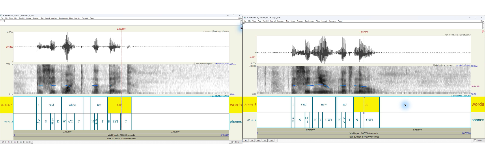

# Assignment 2A | Forced alignment

**FINAL - required evidence gates passed.**

## Method and structural evidence

Only the six provided BU/ISLE recordings were used. BU files have NIST SPHERE headers despite .wav names; preparation decodes and writes RIFF PCM16 at 16 kHz mono, normalizes transcripts into .lab and groups speakers. No outside 2A audio or gold alignments are used.

MFA 3.4.4; official MontrealCorpusTools English US ARPA archive 3.3.0; pinned Hugging Face revision 9c8d5d8e1dd5d9cf188a5571203de0e09ca6bede. Tool-observed MFA validation completed successfully (exit 0). work/validate_arpa/corpus/corpus.log records 97.163 s total audio duration and 258.858 s full validation runtime. These are execution facts, not user attestation or listening-based boundary evaluation. The validator trained a small monophone diagnostic; this is distinct from the primary pretrained alignment model. Kaldi GMM-HMM alignment estimates transcript-constrained word/phone times [A1].

Lexicon: 145 corpus word types; 248 pronunciation rows; 11 base OOV types covered by G2P/manual candidates; 0 final OOV types. Acoustic inventory compatible: True. Source-row counts {'base': 234, 'manual': 12, 'g2p': 2}. Candidate pronunciations are not human gold.

| Recording | Seconds | Words | Phones | Valid / seq. |
|---|---|---|---|---|
| F2BJRLP1 | 25.309 | 68 | 308 | True / True |
| F2BJRLP2 | 28.647 | 73 | 345 | True / True |
| F2BJRLP3 | 30.707 | 82 | 372 | True / True |
| ISLE 01 | 4.125 | 5 | 13 | True / True |
| ISLE 02 | 3.875 | 5 | 12 | True / True |
| ISLE 03 | 4.5 | 5 | 13 | True / True |

Structural checks cover tier presence, interval validity, utterance coverage, gaps and overlaps. All current six rows show zero gaps, overlaps and spn/OOV intervals; normalized word counts are 68/73/82/5/5/5. These checks establish file consistency, not perceptual correctness or boundary accuracy.

## Generated alignment visualizations

Generated waveform/spectrogram/TextGrid plots below are distinct from Praat screenshots. BU figures show excerpts and ISLE figures show full utterances. No manual-listening conclusion is inferred from their existence.

## Praat inspection and limitations

Praat visual inspection: all six recordings were opened in the editor; scoped visual observations and genuine screenshots are recorded below. No listening-based gold labels are claimed.

Recorded observations (plain-text attribution):
# Praat visual inspection, 22 November 2026

All six primary sound/TextGrid pairs were opened in Praat 7.0.03. All three ISLE files were viewed over their full duration; each BU file was viewed in full and zoomed to approximately its first 5.5 seconds. This is a visual boundary inspection, not a listening-based phonetic transcription or a manually annotated gold set. No boundaries or labels were edited.

- ISLE 01: the five words occupy the speech-bearing region; initial and long trailing silence have blank intervals. Word and phone boundaries broadly track visible vowel energy and consonantal transitions. The terminal stop interval extends beyond the strong vowel energy; weak release/noise makes the precise endpoint uncertain. Screenshot praat_isle01.jpg records the genuine editor view.
- ISLE 02: new contains the dictionary variant N Y UW1; no has N OW1. The 350 ms OW1 interval at 1.870-2.220 s includes the falling final voiced region and weak tail. Its endpoint is a timing-review candidate, not a measured error against gold. Screenshot praat_isle02.jpg records this view.
- ISLE 03: AE1 and EH1 are imposed canonical vowel labels in bad and bed. The visible vowel-bearing regions are separated, but forced labels alone cannot establish the speaker produced the intended vowel contrast. Long trailing silence is not assigned to a word.
- BU 01-03: opening word order was checked in detailed waveform/spectrogram views (wanted chief justice; in nineteen seventy six; the author of more than eight hundred). Reduced function words and consonants are densely spaced. The displayed words Dukakis, Hennessy and SJC retain explicit pronunciation-based phone intervals. Full-duration BU views suppress spectrograms beyond Praat's default analysis window, so detailed review used zoomed views.

No skipped words or spn were found in the primary exported sequence. Very short BU phones (29/28/27 at <=31 ms) are duration flags rather than proof of missing phones. No gold boundary MAE is claimed. Separately, the optional English-MFA comparison has a confirmed transcript mismatch in F2BJRLP2 and nine spn intervals across the corpus; these are model/dictionary limitations, not crash corruption. Quantitative agreement is not a substitute for reference boundary accuracy.

Evidence: outputs/praat_screenshots/praat_isle01.jpg and praat_isle02.jpg. These are actual Praat captures, not generated alignment plots. Original primary TextGrids are preserved unchanged.

Duration flags: 84 intervals at 30 ms; 1 above 300 ms. These are review candidates, not confirmed errors. Inspect proper names, initialisms, long pauses and L2 minimal pairs. Without independently reviewed gold, no boundary MAE is reported.

Reproduce using assignment_2a_mfa/README.md and scripts/prepare_models.py, prepare_lexicon.py, run_alignment.py, then evaluate_alignments.py and visualize.py. Regenerate with python tools/build_reports.py. Six source figures: F2BJRLP1_excerpt.png, F2BJRLP2_excerpt.png, F2BJRLP3_excerpt.png, ISLE_SESS0131_BLOCKD02_01_sprt1_full.png, ISLE_SESS0131_BLOCKD02_02_sprt1_full.png, ISLE_SESS0131_BLOCKD02_03_sprt1_full.png.

[A1] McAuliffe et al., Montreal Forced Aligner, Interspeech 2017. https://www.isca-archive.org/interspeech_2017/mcauliffe17_interspeech.html (from PLAN.md). Lexicon audit records model/base dictionary CC BY 4.0. Repository stays private; licensed audio/caches/checkpoints are never committed.

## Pending evidence

No pending requirements recorded.

