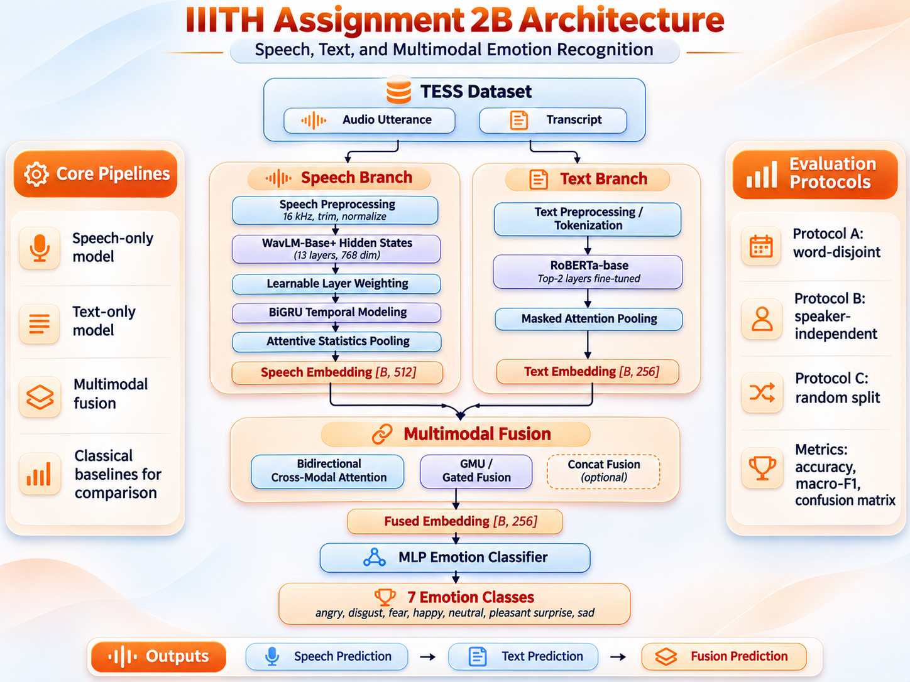
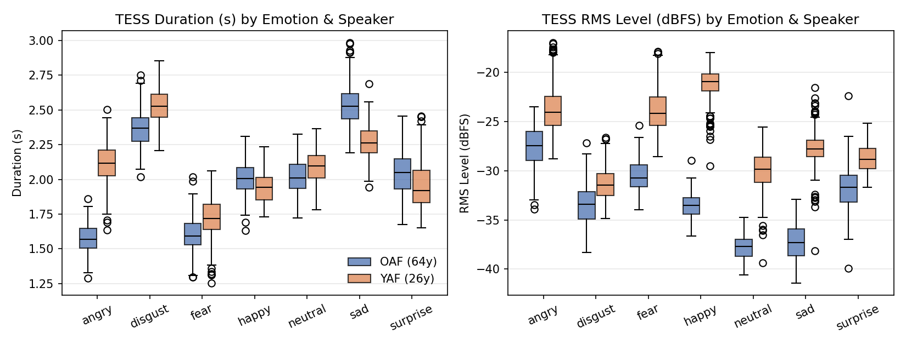
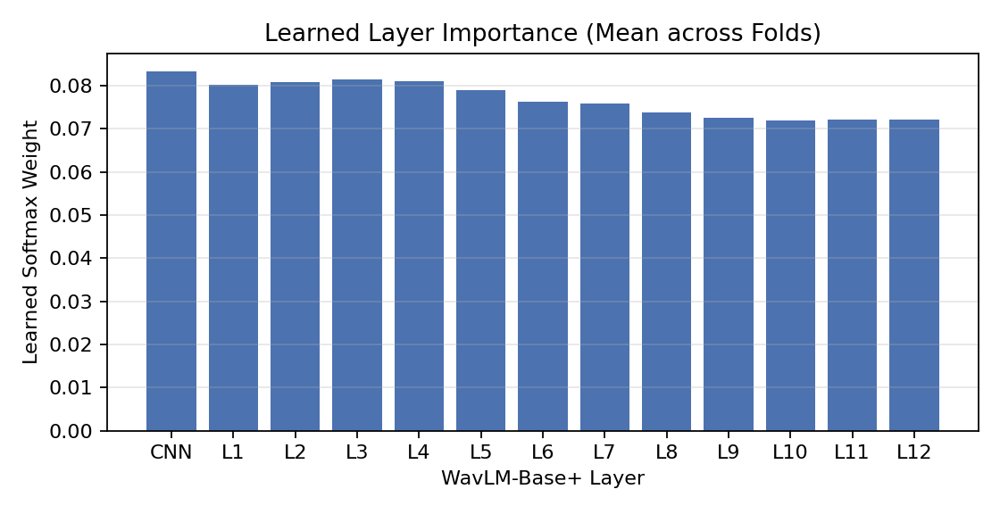
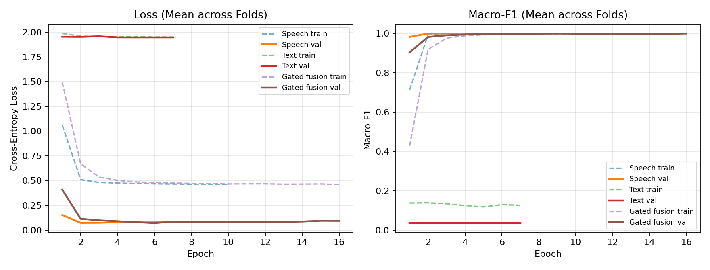
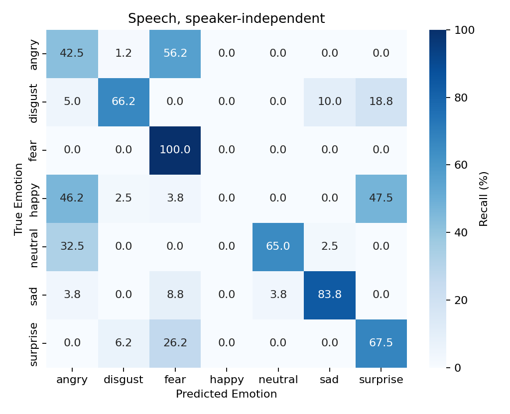
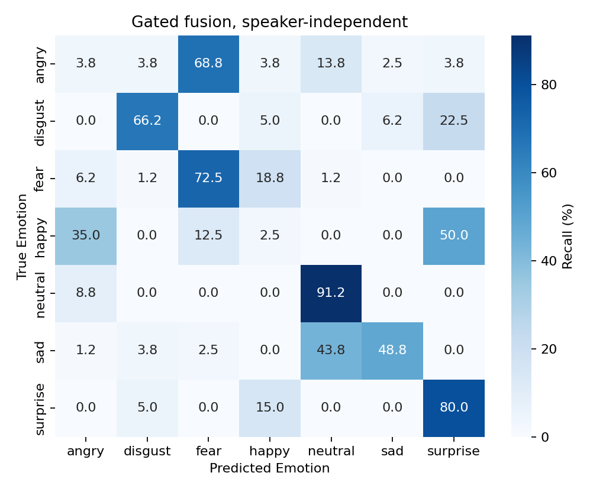

| Quick navigation | Links |
|---|---|
| Reports | [2B final PDF · 19 pages](report/report_2b.pdf) · [Combined report](../Combined_Report.pdf) · [Project overview](../README.md) |
| Evidence | [Full results](Results/accuracy_tables.md) · [Verification](Results/verified_p0/) · [Plots](Results/plots/) · [Failure cases](Results/failure_cases.md) |
| Pipelines | [Speech](models/speech_pipeline/) · [Text](models/text_pipeline/) · [Fusion](models/fusion_pipeline/) · [Reproducibility](#reproducibility) |

# Assignment 2B · Multimodal emotion recognition

## Main experimental results and performance plots

Six model families are evaluated under three fixed protocols. Entries are accuracy / macro-F1 (%), unweighted fold means. [Full precision and population standard deviations](Results/accuracy_tables.csv).

| Model | Protocol A | Protocol B | Protocol C |
|---|---:|---:|---:|
| eGeMAPS+SVM | 98.43 / 98.43 | 18.04 / 12.45 | 98.54 / 98.55 |
| TFIDF+LogReg | 14.29 / 3.57 | 14.29 / 3.57 | 0.00 / 0.00 |
| fusion_concat | 99.82 / 99.82 | 43.75 / 34.44 | 99.71 / 99.72 |
| fusion_gated_xattn | 99.79 / 99.79 | 52.14 / 46.40 | 99.82 / 99.82 |
| speech_wavlm_bigru_asp | 99.96 / 99.96 | 60.71 / 56.23 | 99.86 / 99.86 |
| text_roberta_top2ft | 14.29 / 3.57 | 14.29 / 6.31 | 14.25 / 4.34 |


## Architecture and technical design



The five functional blocks are preprocessing, feature extraction, temporal/contextual modelling, fusion and classification. Speech is represented by frame sequences and ASP embeddings; text by contextual token sequences and a pooled embedding. Each required pipeline has separate train/test entry points.

**Diagram clarifications:** WavLM's 13 cached states comprise the convolutional representation plus 12 Transformer states. Gated cross-attention consumes projected **frame/token sequences before pooling**, rather than only the pooled vectors shown schematically. Concatenation uses pooled projected embeddings and was evaluated for A/B/C despite its optional label. `surprise` is the stored alias for pleasant surprise, not an eighth class.

## TESS dataset and preprocessing

TESS contains 2,800 clips: two speakers x 200 target words x seven emotions, 400 examples per class. Filename emotion suffixes are removed before constructing `Say the word <target>` carrier transcripts. Audio is mono 16 kHz, trimmed at 30 dB with 50 ms padding and peak-normalized to -1 dBFS. Raw data and cached features are excluded from Git.



[Dataset audit](Results/data_audit.md) · [Data preparation](src/mer/data/) · [Feature extraction](src/mer/features/).

## WavLM-BiGRU-ASP speech pipeline

Frozen WavLM-Base+ states are cached as fp16 `[13,T,768]`. A learned softmax layer weighting, training-only SpecAugment and 768->256 projection precede a single bidirectional GRU (128 units per direction). Attentive statistics pooling concatenates weighted mean and standard deviation into a 512-dimensional utterance vector. A dropout-regularized MLP predicts seven classes.



[Speech implementation](src/mer/models/speech.py) · [Configuration](configs/speech.yaml) · [Detailed speech schematic](../docs/figures/arch_2b_speech.png).

## RoBERTa contextual text pipeline

RoBERTa-base tokenizes carrier transcripts (maximum length 32). The top two Transformer layers are fine-tuned; 768-dimensional contextual tokens project to 256 dimensions and masked attention pooling produces a 256-dimensional utterance embedding before classification. Near-chance accuracy is consistent with emotion-independent carrier text.

[Text implementation](src/mer/models/text.py) · [Configuration](configs/text.yaml) · [Detailed text schematic](../docs/figures/arch_2b_text.png).

## Gated cross-attention and concatenation fusion

The concatenation baseline projects pooled speech (512->256) and text (256->256), concatenates them and maps 512->256 before classification. Gated fusion uses four-head bidirectional cross-attention over 256-dimensional speech frames and text tokens, residual layer normalization and masked pooling. A 256-dimensional sigmoid vector gate mixes the two attended summaries, followed by the classifier. Modality dropout probability is 0.2 with mutually exclusive stream dropping.

[Fusion implementation](src/mer/models/fusion.py) · [Gated configuration](configs/fusion.yaml) · [Concatenation configuration](configs/fusion_concat.yaml) · [Detailed fusion schematic](../docs/figures/arch_2b_fusion.png) · [Functional overview](../docs/figures/arch_2b_overview.png).

## Training configuration and evaluation protocols

| Setting | Speech / fusion | Text |
|---|---|---|
| Batch size | 32 | 32 |
| Maximum epochs / patience | 40 / 8 | 20 / 6 |
| Head learning rate | 0.001 | 0.001 |
| Text encoder learning rate | 0.00002 when present | 0.00002 |
| Optimizer / weight decay | AdamW / 0.01 | AdamW / 0.01 |
| Label smoothing | 0.1 | 0.1 |

| Protocol | Folds | Train / validation / test clips | Disjointness |
|---|---:|---|---|
| A | 5 | 1792 / 448 / 560 | 128 / 32 / 40 distinct words; both speakers shared |
| B | 2 | 896 / 224 / 280 | Words and train/test speakers disjoint; opposite-speaker transfer |
| C | 5 | 1960 / 280 / 560 | Random stratified 70/10/20%; words and speakers overlap |

[Fixed split manifests](splits/) · [Leakage tests](tests/test_splits.py) · [All configurations](configs/).



Gated Protocol C epoch history is unavailable; no substitute curve is inferred.

## Baselines, ablations, confusion matrices and per-emotion metrics

The classical speech baseline uses 88-dimensional eGeMAPS with scaled SVM; the text baseline uses TF-IDF and logistic regression. [Classical implementation](src/mer/models/classical.py). Full metrics above include both baselines.

| Gated fusion ablation | Accuracy (%) | Macro-F1 (%) |
|---|---:|---:|
| A, zero text | 91.96 | 90.79 |
| B, zero text | 54.64 | 48.94 |

Zero-text is an evaluation intervention, not a retrained architecture. In B, gated fusion helps 45 examples but harms 93 relative to speech; improvements for neutral and surprise do not offset the overall loss. [Paired analysis](Results/comparative_analysis.md) · [Per-emotion metrics](Results/per_emotion_validated.csv).





### Per-emotion recall

| Emotion | Speech Proto A (%) | Speech Proto B (%) | Text Proto B (%) | Concat Fusion Proto B (%) | Gated Fusion Proto B (%) |
|---|---:|---:|---:|---:|---:|
| **angry** | 100.00 | 42.50 | 1.25 | 40.00 | 3.75 |
| **disgust** | 100.00 | 66.25 | 0.00 | 48.75 | 66.25 |
| **fear** | 100.00 | **100.00** | 36.25 | 92.50 | 72.50 |
| **happy** | 100.00 | **0.00** | 13.75 | 1.25 | 2.50 |
| **neutral** | 100.00 | 65.00 | 11.25 | 50.00 | **91.25** |
| **sad** | 100.00 | 83.75 | 0.00 | 18.75 | 48.75 |
| **surprise** | 99.75 | 67.50 | 37.50 | 55.00 | **80.00** |


[All model/protocol confusion matrices](Results/plots/) · [Per-fold results](Results/per_fold/).

## UMAP, t-SNE and five verified failure cases

Both projection figures show Protocol A fold 0 test examples across temporal (speech ASP, 512-d), contextual (text pool, 256-d) and gated fusion (256-d) blocks. Projection geometry is descriptive and does not establish unseen-speaker robustness or causal modality contributions.


[UMAP projection metrics](Results/plots/embeddings_umap_protoA_metrics.json) · [t-SNE projection metrics](Results/plots/embeddings_tsne_protoA_metrics.json) · [Prediction-backed failure cases](Results/failure_cases.md).

| # | Protocol / Run | Utterance ID | Speaker | Word | True → Predicted | Confidence | Duration (s) | Mean F0 (Hz) |
|---|---|---|---:|---|---|---:|---:|---:|
| 1 | Proto A (`speech_wavlm_bigru_asp_protoA` f0) | `OAF_make_surprise` | OAF | `make` | **surprise → happy** | 0.568 | 2.08 | 226.0 |
| 2 | Proto B (`speech_wavlm_bigru_asp_protoB` f0) | `YAF_fall_angry` | YAF | `fall` | **angry → fear** | 0.825 | 1.78 | 237.2 |
| 3 | Proto B (`speech_wavlm_bigru_asp_protoB` f1) | `OAF_cool_happy` | OAF | `cool` | **happy → surprise** | 0.763 | 2.07 | 252.8 |
| 4 | Proto B (`speech_wavlm_bigru_asp_protoB` f1) | `OAF_cool_neutral` | OAF | `cool` | **neutral → angry** | 0.747 | 1.98 | 206.0 |
| 5 | Proto B (`speech_wavlm_bigru_asp_protoB` f0) | `YAF_week_happy` | YAF | `week` | **happy → angry** | 0.710 | 1.54 | 286.7 |


## Reproducibility

Use Python 3.10, the [root dependencies](../requirements.txt) and the [component requirements](requirements.txt). Install the matching PyTorch/CUDA build for the target hardware. Restore licensed TESS data and model downloads locally. The commands below are for a separate reproduction workspace; use new run names and do not overwrite preserved evaluations.

<details>
<summary>Preparation, cached features and pipeline train/test commands</summary>

Run from `assignment_2b_emotion/` with `PYTHONPATH` pointing to `src`:

```powershell
$env:PYTHONPATH = (Resolve-Path src).Path

# 1. Download & prepare TESS dataset (2,800 clips) and run split leakage tests
python -m mer.data.download_tess --out data/raw/TESS
python -m mer.data.prepare_tess --raw data/raw/TESS --out data/metadata.csv
python -m pytest tests -q

# 2. Preprocess 16 kHz audio and extract eGeMAPS (88-d) + WavLM-Base+ ([13, T, 768] fp16)
python -m mer.features.preprocess_audio --meta data/metadata.csv --out data/processed_16k
python -m mer.features.extract_egemaps --meta data/metadata.csv --out data/features/egemaps.csv
python -m mer.features.extract_ssl --meta data/metadata.csv --model microsoft/wavlm-base-plus --tag wavlm_base_plus --out data/features --batch_size 8

# 3. Required Deliverable Entry Points (Speech, Text, Fusion across Protocols A, B, C)
python models/speech_pipeline/train.py --config configs/speech.yaml --protocol A --name repro_speech_A
python models/speech_pipeline/test.py  --config configs/speech.yaml --protocol A --name repro_speech_A

python models/text_pipeline/train.py   --config configs/text.yaml --protocol A --name repro_text_A
python models/text_pipeline/test.py    --config configs/text.yaml --protocol A --name repro_text_A

python models/fusion_pipeline/train.py --config configs/fusion.yaml --protocol A --name repro_gated_A
python models/fusion_pipeline/test.py  --config configs/fusion.yaml --protocol A --name repro_gated_A

python models/fusion_pipeline/train.py --config configs/fusion_concat.yaml --protocol A --name repro_concat_A
python models/fusion_pipeline/test.py  --config configs/fusion_concat.yaml --protocol A --name repro_concat_A
```

Repeat required runs with `--protocol B` and `--protocol C`, using unique corresponding run names. Saved-checkpoint test entry points avoid retraining; supply the name of the existing run only when deliberately evaluating it. Classical baselines and plotting scripts are linked for reproduction rather than executed here.

</details>

[Training/evaluation source](src/mer/) · [Tests](tests/) · [Saved evaluation verification](Results/verified_p0/) · [Consolidated evaluation validation](Results/evaluation_validation.json).

## Limitations and provenance

TESS has only two actors and acted emotions. Protocol C shares speakers and words; its high scores do not establish unseen-speaker generalization. Protocol B is the relevant transfer stress test. The carrier transcript supplies no reliable emotion semantics. Neither fusion variant improves overall macro-F1 over speech alone.

Classical estimators fit train+validation data; neural models train on the training partition with validation selection. This difference limits direct fairness claims. The TF-IDF Protocol C zero score reflects finite split/complement effects, not evidence of emotion recognition. Accuracy chance is 1/7 on balanced labels; macro-F1 has no universal chance value.

Saved neural checkpoint-to-prediction mappings were independently re-evaluated and hash-checked. Complete historical RoBERTa training lineage is not recoverable; final evaluation verification does not establish that lineage. Gated Protocol C epoch history is unavailable. Gate values and low-dimensional projections do not prove causal modality importance or speaker invariance.

## References

- [MFA: McAuliffe et al. (2017)](https://www.isca-archive.org/interspeech_2017/mcauliffe17_interspeech.html).
- [WavLM: Chen et al.](https://arxiv.org/abs/2110.13900); [attentive statistics pooling: Okabe et al.](https://arxiv.org/abs/1803.10963).
- [RoBERTa: Liu et al.](https://arxiv.org/abs/1907.11692).
- [MulT: Tsai et al.](https://arxiv.org/abs/1906.00295); [gated multimodal units: Arevalo et al.](https://arxiv.org/abs/1702.01992). These motivate the custom fusion architecture; this is not a reproduction of either paper.
- [TESS dataset: Pichora-Fuller and Dupuis](https://doi.org/10.5683/SP2/E8H2MF).
