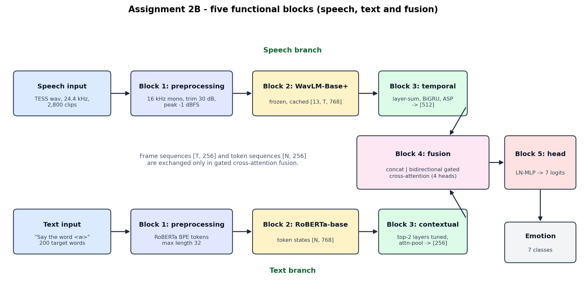
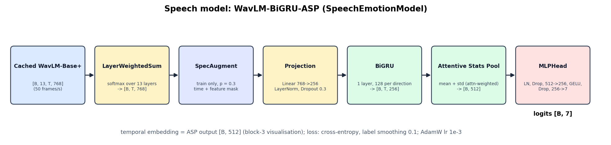
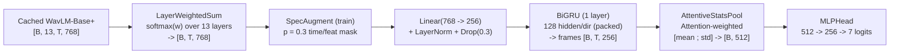
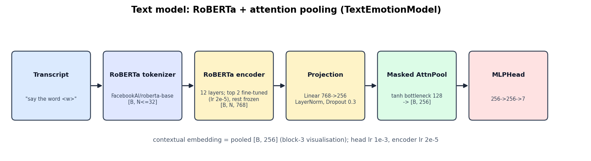
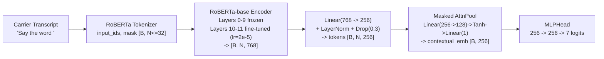
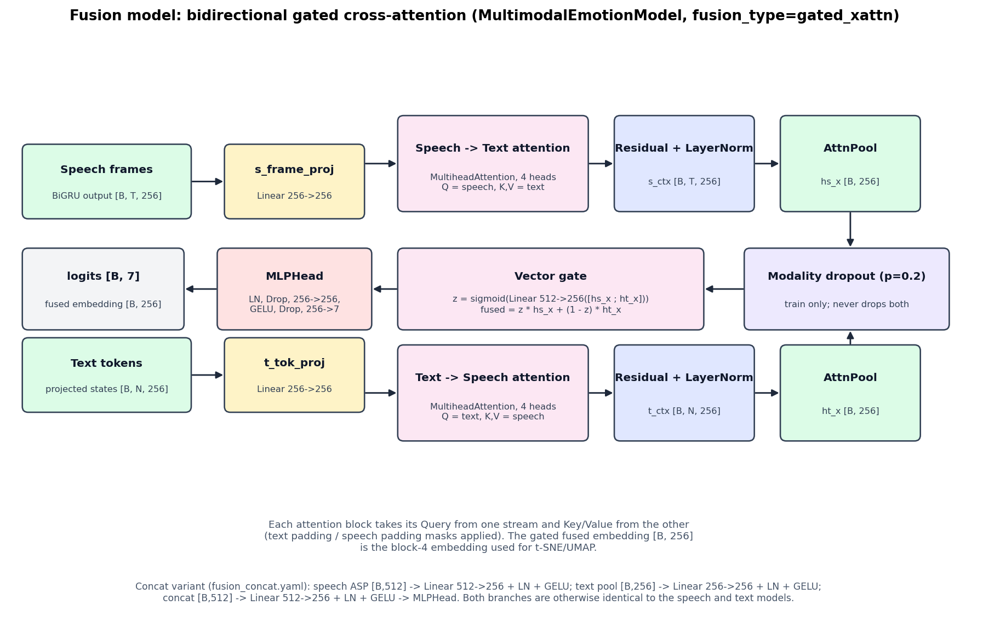
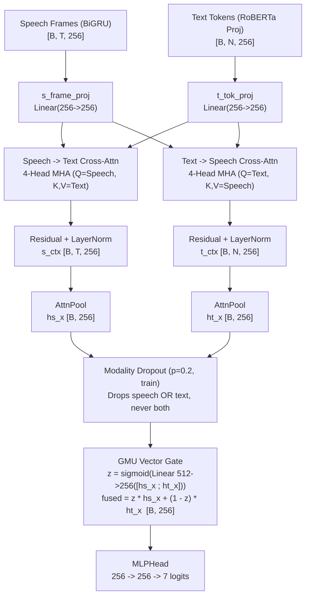
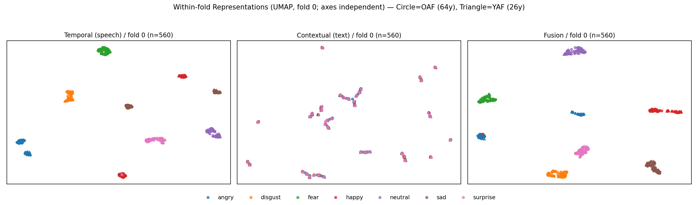
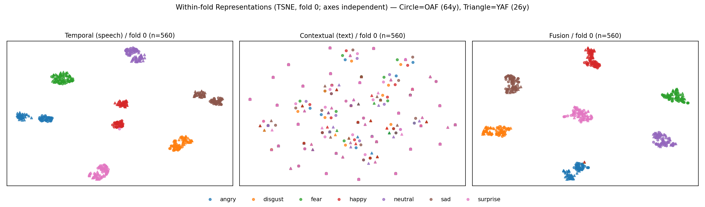
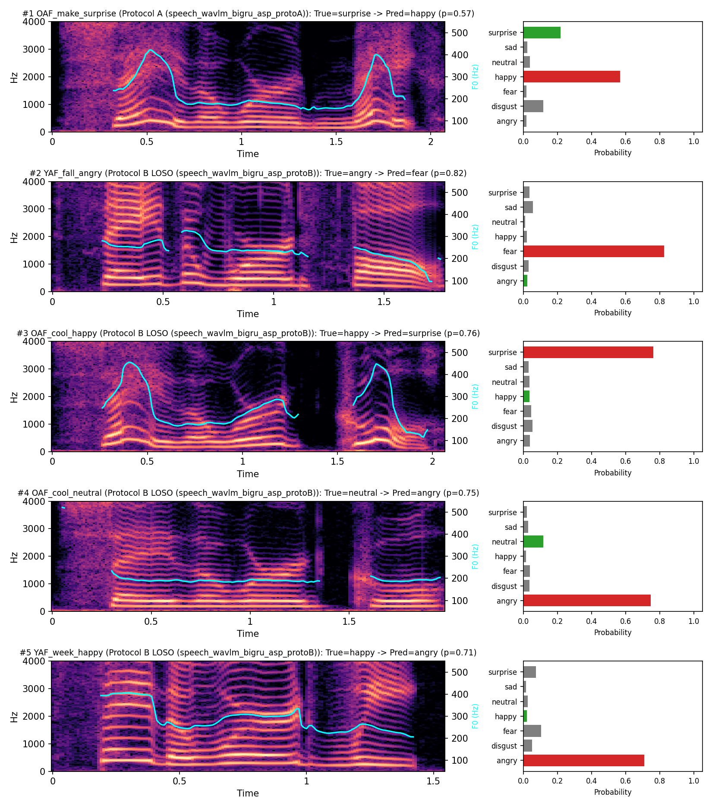

# Assignment 2B: Multimodal Emotion Recognition (Speech, Text & Fusion)

Complete, modular implementation and evaluation framework for **Assignment 2B** on the **Toronto Emotional Speech Set (TESS)**, comparing speech-only, text-only, and multimodal speech+text fusion models across three leakage-controlled cross-validation protocols.

- **Final Technical Report (PDF, 15 pages)**: [`report/report_2b.pdf`](report/report_2b.pdf)
- **Required Pipeline Scripts (`train.py` & `test.py`)**: [`models/speech_pipeline/`](models/speech_pipeline/), [`models/text_pipeline/`](models/text_pipeline/), [`models/fusion_pipeline/`](models/fusion_pipeline/)
- **Consolidated Accuracy Tables**: [`Results/accuracy_tables.md`](Results/accuracy_tables.md), [`Results/accuracy_tables.csv`](Results/accuracy_tables.csv)
- **Per-Emotion Recall, Paired McNemar & Help/Harm Analysis**: [`Results/comparative_analysis.md`](Results/comparative_analysis.md), [`Results/per_emotion_validated.csv`](Results/per_emotion_validated.csv)
- **5 Prediction-Backed Failure Cases & 26 Evaluation Plots**: [`Results/failure_cases.md`](Results/failure_cases.md), [`Results/plots/`](Results/plots/)

---

## 1. System Overview & Functional Block Mapping

The assignment specifies five functional blocks: **(1) Preprocessing**, **(2) Feature Extraction**, **(3) Temporal / Contextual Modelling**, **(4) Fusion**, and **(5) Classifier**.



| Functional Block | Speech Pipeline (`configs/speech.yaml`) | Text Pipeline (`configs/text.yaml`) | Multimodal Fusion (`configs/fusion.yaml`, `fusion_concat.yaml`) |
|---|---|---|---|
| **1. Preprocessing** | 16 kHz mono, 30 dB silence trim (+50 ms pad), -1 dBFS peak normalization (`preprocess_audio.py`) | Standardized carrier transcript `"Say the word <w>"` (filename emotion suffix stripped), RoBERTa BPE (`max_len=32`) | Joint audio + carrier transcript loading via `TESSDataset` (`src/mer/data/datasets.py`) |
| **2. Feature Extraction** | Frozen **WavLM-Base+** (`microsoft/wavlm-base-plus`) all 13 layers cached in fp16 `[13, T, 768]`; plus 88-d **eGeMAPS** for classical SVM | Pretrained **RoBERTa-base** (`FacebookAI/roberta-base`) token representations `[N, 768]`; plus 1–2 gram **TF-IDF** for LogReg | Cached WavLM `[13, T, 768]` + RoBERTa token states `[N, 768]` |
| **3. Temporal / Contextual Modelling** | Learnable 13-layer softmax weighted sum → SpecAugment ($p=0.3$) → Linear(768→256) + LN → **1-layer BiGRU** ($128\times 2$) → **Attentive Statistics Pooling** (mean+std, `[B, 512]`) | Top-2 RoBERTa layers fine-tuned ($\text{lr}=2\times 10^{-5}$) → Linear(768→256) + LN → **Masked Attention Pooling** (`[B, 256]`) | Parallel SpeechBranch (`frames [B, T, 256]`, `emb [B, 512]`) and TextBranch (`tokens [B, N, 256]`, `emb [B, 256]`) |
| **4. Fusion** | — | — | **Concat**: `[s_proj(512→256) ; t_proj(256→256)]` → Linear(512→256)+LN+GELU<br>**Gated Cross-Attn**: 4-head `s2t` & `t2s` cross-attention + residual LN + AttnPool + Modality Dropout ($p=0.2$) + Vector Gate $\mathbf{z} \odot \mathbf{h}_s^x + (1-\mathbf{z}) \odot \mathbf{h}_t^x \in \mathbb{R}^{256}$ |
| **5. Classifier** | `MLPHead`: LayerNorm(512) → Dropout(0.3) → Linear(512→256) → GELU → Dropout(0.3) → Linear(256→7) | `MLPHead`: LayerNorm(256) → Dropout(0.3) → Linear(256→256) → GELU → Dropout(0.3) → Linear(256→7) | `MLPHead`: LayerNorm(256) → Dropout(0.3) → Linear(256→256) → GELU → Dropout(0.3) → Linear(256→7) |

---

## 2. Detailed Pipeline Architectures

### 2.1 Speech Pipeline (`SpeechEmotionModel` — `src/mer/models/speech.py`)





### 2.2 Text Pipeline (`TextEmotionModel` — `src/mer/models/text.py`)





### 2.3 Multimodal Fusion Pipeline (`MultimodalEmotionModel` — `src/mer/models/fusion.py`)





---

## 3. Dataset Audit & Three Frozen Evaluation Protocols

### TESS Dataset Audit ([`Results/data_audit.md`](Results/data_audit.md))
- **2,800 clips**: 2 female speakers (`OAF`: 64 yr, 1,400 clips; `YAF`: 26 yr, 1,400 clips) × 200 target words × 7 emotions (`angry`, `disgust`, `fear`, `happy`, `neutral`, `sad`, `surprise`, 400 clips each).
- **Zero duplicates**: 0 duplicate MD5 hashes, 0 missing `(speaker, word, emotion)` combinations. Quirky filename `OA_bite_neutral.wav` is automatically normalized to `OAF`.
- **Uniform Text Conditional Distribution**: Because every target word is spoken in all 7 emotions by both speakers, $P(\text{emotion} \mid \text{text}) = 1/7 = 14.29\%$ across the dataset.

### Frozen Split Protocols ([`splits/`](splits/), Verified by [`tests/test_splits.py`](tests/test_splits.py))

| Protocol | Folds | Train / Val / Test per Fold | Lexical Word Disjointness | Speaker Disjointness | Scientific Role |
|:---:|:---:|:---:|:---:|:---:|---|
| **A** | 5 | `1,792 / 448 / 560` (128 / 32 / 40 words) | **Strict** (0 shared words) | Shared (`OAF` + `YAF`) | Primary lexical-generalization benchmark |
| **B** | 2 | `896 / 224 / 280` (128 / 32 / 40 words) | **Strict** (0 shared words) | **Strict LOSO** (1 speaker train/val, 1 test) | Unseen-speaker + unseen-word transfer stress test |
| **C** | 5 | `1,960 / 280 / 560` (70% / 10% / 20%) | Shared words | Shared (`OAF` + `YAF`) | Optimistic random stratified reference |

---

## 4. Verified Results Across All Models & Protocols

All 12 neural headline runs were independently re-evaluated from saved checkpoints into [`Results/verified_p0/`](Results/verified_p0/) with SHA-256 verification sidecars (`verification.json`). Values below are unweighted fold means ± population SD (`ddof=0`) from [`Results/accuracy_tables.md`](Results/accuracy_tables.md):

| Run ID | Modality | Protocol | Folds | Accuracy (%) | UAR (%) | Macro-F1 (%) |
|---|---|:---:|:---:|---:|---:|---:|
| `speech_wavlm_bigru_asp_protoA` | Speech | **A** | 5 | **99.96 ± 0.07** | **99.96 ± 0.07** | **99.96 ± 0.07** |
| `speech_wavlm_bigru_asp_protoB` | Speech | **B** | 2 | **60.71 ± 8.21** | **60.71 ± 8.21** | **56.23 ± 7.53** |
| `speech_wavlm_bigru_asp_protoC` | Speech | **C** | 5 | **99.86 ± 0.13** | **99.86 ± 0.13** | **99.86 ± 0.13** |
| `text_roberta_top2ft_protoA` | Text | **A** | 5 | 14.29 ± 0.00 | 14.29 ± 0.00 | 3.57 ± 0.00 |
| `text_roberta_top2ft_protoB` | Text | **B** | 2 | 14.29 ± 0.00 | 14.29 ± 0.00 | 6.31 ± 0.22 |
| `text_roberta_top2ft_protoC` | Text | **C** | 5 | 14.25 ± 0.62 | 14.25 ± 0.62 | 4.34 ± 0.97 |
| `fusion_concat_protoA` | Fusion | **A** | 5 | 99.82 ± 0.11 | 99.82 ± 0.11 | 99.82 ± 0.11 |
| `fusion_concat_protoB` | Fusion | **B** | 2 | 43.75 ± 5.89 | 43.75 ± 5.89 | 34.44 ± 4.66 |
| `fusion_concat_protoC` | Fusion | **C** | 5 | 99.71 ± 0.27 | 99.71 ± 0.27 | 99.72 ± 0.27 |
| `fusion_gated_xattn_protoA` | Fusion | **A** | 5 | 99.79 ± 0.13 | 99.79 ± 0.13 | 99.79 ± 0.13 |
| `fusion_gated_xattn_protoB` | Fusion | **B** | 2 | 52.14 ± 5.36 | 52.14 ± 5.36 | 46.40 ± 1.44 |
| `fusion_gated_xattn_protoC` | Fusion | **C** | 5 | 99.82 ± 0.28 | 99.82 ± 0.28 | 99.82 ± 0.28 |
| `fusion_gated_xattn_protoA_zerotext` | Ablation | **A** | 5 | 91.96 ± 8.82 | 91.96 ± 8.82 | 90.79 ± 10.26 |
| `fusion_gated_xattn_protoB_zerotext` | Ablation | **B** | 2 | 54.64 ± 7.14 | 54.64 ± 7.14 | 48.94 ± 5.68 |
| `classical_speech_protoA` (`eGeMAPS+SVM`) | Speech | **A** | 5 | 98.43 ± 0.58 | 98.43 ± 0.58 | 98.43 ± 0.58 |
| `classical_speech_protoB` (`eGeMAPS+SVM`) | Speech | **B** | 2 | 18.04 ± 1.61 | 18.04 ± 1.61 | 12.45 ± 0.71 |
| `classical_speech_protoC` (`eGeMAPS+SVM`) | Speech | **C** | 5 | 98.54 ± 0.50 | 98.54 ± 0.50 | 98.55 ± 0.49 |
| `classical_text_protoA` (`TF-IDF+LR`) | Text | **A** | 5 | 14.29 ± 0.00 | 14.29 ± 0.00 | 3.57 ± 0.00 |
| `classical_text_protoB` (`TF-IDF+LR`) | Text | **B** | 2 | 14.29 ± 0.00 | 14.29 ± 0.00 | 3.57 ± 0.00 |
| `classical_text_protoC` (`TF-IDF+LR`) | Text | **C** | 5 | 0.00 ± 0.00 | 0.00 ± 0.00 | 0.00 ± 0.00 |

---

## 5. Analysis, Visualizations & Failure Cases

### 5.1 Per-Emotion Recall & Cross-Speaker Arousal Collapse (Protocol B vs. Protocol A)

| Emotion | Speech Proto A (%) | Speech Proto B (%) | Text Proto B (%) | Concat Fusion Proto B (%) | Gated Fusion Proto B (%) |
|---|---:|---:|---:|---:|---:|
| **angry** | 100.00 | 42.50 | 1.25 | 40.00 | 3.75 |
| **disgust** | 100.00 | 66.25 | 0.00 | 48.75 | 66.25 |
| **fear** | 100.00 | **100.00** | 36.25 | 92.50 | 72.50 |
| **happy** | 100.00 | **0.00** | 13.75 | 1.25 | 2.50 |
| **neutral** | 100.00 | 65.00 | 11.25 | 50.00 | **91.25** |
| **sad** | 100.00 | 83.75 | 0.00 | 18.75 | 48.75 |
| **surprise** | 99.75 | 67.50 | 37.50 | 55.00 | **80.00** |

### 5.2 Embedding Separability Across Functional Blocks (`Temporal`, `Contextual`, `Fusion`)
Within-fold projections on Protocol A Fold 0 (`n = 560` test utterances, [`Results/plots/embeddings_umap_protoA_metrics.json`](Results/plots/embeddings_umap_protoA_metrics.json)):
- **Temporal Block (Speech ASP, 512-d)**: Emotion Silhouette = **`+0.486`**, Speaker Silhouette = **`+0.017`** (strong emotion clustering, speaker-invariant).
- **Contextual Block (Text Pool, 256-d)**: Emotion Silhouette = **`-0.013`**, Speaker Silhouette = **`-0.004`** (complete overlap across emotions).
- **Fusion Block (Gated Cross-Attn, 256-d)**: Emotion Silhouette = **`+0.780`**, Speaker Silhouette = **`+0.005`** (compact class clusters driven by the acoustic stream).

| Within-Fold UMAP (Temporal, Contextual, Fusion) | Within-Fold t-SNE (Temporal, Contextual, Fusion) |
|---|---|
|  |  |

### 5.3 Five Prediction-Backed Failure Cases ([`Results/failure_cases.md`](Results/failure_cases.md))

| # | Protocol / Run | Utterance ID | Speaker | Word | True → Predicted | Confidence | Duration (s) | Mean F0 (Hz) |
|---|---|---|---:|---|---|---:|---:|---:|
| 1 | Proto A (`speech_wavlm_bigru_asp_protoA` f0) | `OAF_make_surprise` | OAF | `make` | **surprise → happy** | 0.568 | 2.08 | 226.0 |
| 2 | Proto B (`speech_wavlm_bigru_asp_protoB` f0) | `YAF_fall_angry` | YAF | `fall` | **angry → fear** | 0.825 | 1.78 | 237.2 |
| 3 | Proto B (`speech_wavlm_bigru_asp_protoB` f1) | `OAF_cool_happy` | OAF | `cool` | **happy → surprise** | 0.763 | 2.07 | 252.8 |
| 4 | Proto B (`speech_wavlm_bigru_asp_protoB` f1) | `OAF_cool_neutral` | OAF | `cool` | **neutral → angry** | 0.747 | 1.98 | 206.0 |
| 5 | Proto B (`speech_wavlm_bigru_asp_protoB` f0) | `YAF_week_happy` | YAF | `week` | **happy → angry** | 0.710 | 1.54 | 286.7 |



---

## 6. Reproducibility & Execution Commands

Run from `assignment_2b_emotion/` with `PYTHONPATH` pointing to `src`:

```powershell
$env:PYTHONPATH = (Resolve-Path src).Path

# 1. Download & prepare TESS dataset (2,800 clips) and run split leakage tests
python -m mer.data.download_tess --out data/raw/TESS
python -m mer.data.prepare_tess --raw data/raw/TESS --out data/metadata.csv
python -m pytest tests -q

# 2. Preprocess 16 kHz audio and extract eGeMAPS (88-d) + WavLM-Base+ ([13, T, 768] fp16)
python -m mer.features.preprocess_audio --meta data/metadata.csv --out data/processed_16k
python -m mer.features.extract_egemaps --meta data/metadata.csv --out data/features/egemaps.csv
python -m mer.features.extract_ssl --meta data/metadata.csv --model microsoft/wavlm-base-plus --tag wavlm_base_plus --out data/features --batch_size 8

# 3. Required Deliverable Entry Points (Speech, Text, Fusion across Protocols A, B, C)
python models/speech_pipeline/train.py --config configs/speech.yaml --protocol A --name repro_speech_A
python models/speech_pipeline/test.py  --config configs/speech.yaml --protocol A --name repro_speech_A

python models/text_pipeline/train.py   --config configs/text.yaml --protocol A --name repro_text_A
python models/text_pipeline/test.py    --config configs/text.yaml --protocol A --name repro_text_A

python models/fusion_pipeline/train.py --config configs/fusion.yaml --protocol A --name repro_gated_A
python models/fusion_pipeline/test.py  --config configs/fusion.yaml --protocol A --name repro_gated_A

python models/fusion_pipeline/train.py --config configs/fusion_concat.yaml --protocol A --name repro_concat_A
python models/fusion_pipeline/test.py  --config configs/fusion_concat.yaml --protocol A --name repro_concat_A

# 4. Classical Baselines (eGeMAPS+SVM and TF-IDF+LogReg)
python -m mer.models.classical --modality speech --protocol A
python -m mer.models.classical --modality text   --protocol A
```
