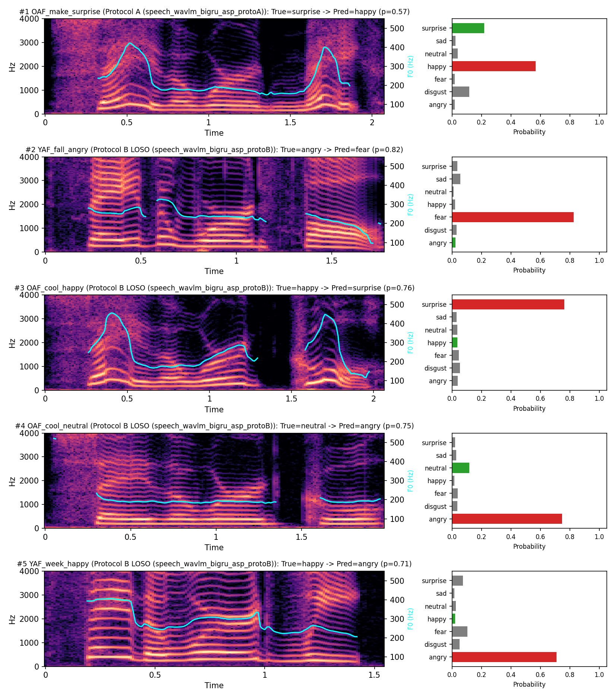

# Assignment 2B | Multimodal emotion recognition

**DRAFT - pending evidence remains.**

## Dataset, splits and completion

Four headline systems (speech, text, concat fusion, gated fusion) under A/B/C require 12 complete validated runs. Ongoing/partial jobs are pending, never completed results. Checkpoint provenance must be reconciled after the recorded process collision; P0 text completion markers cannot prove correspondence to current checkpoint bytes.

Metadata: 2800 clips; 2800 unique IDs; 200 words; 2 speakers. Class counts {'0': 400, '1': 400, '2': 400, '3': 400, '4': 400, '5': 400, '6': 400}. TESS uses two female speakers and seven acted emotions; filename-derived text is Say the word <target> after stripping speaker/emotion suffixes. Source [B6]: Borealis DOI 10.5683/SP2/E8H2MF. Keep data and repository private; retain source license/attribution.

| Protocol | Frozen split | Interpretation |
|---|---|---|
| A | 5 folds: 128/32/40 disjoint words | Primary lexical generalization; speakers shared |
| B | 2 folds: speaker transfer plus word disjoint; 40 test words | Stress test; two speakers limit generalization |
| C | 5 random stratified folds; ~70/10/20% | Optimistic reference; words and speakers shared |

Neural models fit training IDs and select best validation macro-F1 checkpoints. All models reuse frozen splits; no test tuning. Accuracy, UAR and macro-F1 are independently recomputed from saved test predictions. Tables show unweighted fold means +/- population fold SD (ddof=0), not confidence intervals.

| System | A | B | C |
|---|---|---|---|
| Speech | prediction-audited; CSV pending | prediction-audited; CSV pending | prediction-audited; CSV pending |
| Text | PENDING | PENDING | PENDING |
| Concat | PENDING | PENDING | PENDING |
| Gated | PENDING | PENDING | PENDING |

## Architecture and block justifications

| Block | Implementation | Justification / limitation |
|---|---|---|
| Speech preprocessing | 16 kHz mono; trim 30 dB, 50 ms padding; peak -1 dBFS | Standardizes rate/channel, retains boundary context. Normalization may alter loudness cues. |
| Speech features | Frozen WavLM-Base+ [B1], [13,T,768]; learned layer sum | Caching fits limited GPU memory; weights adapt layer contributions without encoder fine-tuning. |
| Temporal block | 256 projection; bidirectional GRU, 128 each direction; attentive mean/std [B2] | Models sequence dynamics, salience and feature dispersion rather than only a global average. |
| Text features | RoBERTa token embeddings [B3], max length 32 | Deterministic transcript; no filename emotion suffix is passed as input. |
| Contextual block | Top two transformer layers fine-tuned; 256 projection; masked attention pooling | Limits trainable parameters, preserves token context and produces fixed-size representation. |
| Fusion/classifier | Concat or bidirectional 4-head cross attention + vector gate, 256 dims; MLP -> 7 logits [B4,B5] | Concat comparator isolates fusion complexity. Cross attention exchanges sequence context; gate weights are descriptive, not causal. |

| Config | Batch | Epoch cap | Patience | Head LR | Encoder LR |
|---|---|---|---|---|---|
| speech | 32 | 40 | 8 | 0.001 | - |
| text | 32 | 20 | 6 | 0.001 | 2e-05 |
| fusion_concat | 32 | 40 | 8 | 0.001 | 2e-05 |
| fusion | 32 | 40 | 8 | 0.001 | 2e-05 |

Training settings are read from the current configuration files in the table. Implemented optimizer is AdamW with validation macro-F1 selection. See hashed configs for weight decay, smoothing, dropout and augmentation settings. Config snapshots are authoritative; report manifest hashes current config files. Gated mean closer to one weights the speech-side representation more, but cannot establish causal reliance.

References transcribed from PLAN.md: [B1] Chen et al., WavLM, IEEE JSTSP 2022, arXiv 2110.13900. [B2] Okabe et al., Attentive Statistics Pooling, Interspeech 2018, arXiv 1803.10963. [B3] Liu et al., RoBERTa, 2019, arXiv 1907.11692. [B4] Tsai et al., MulT, ACL 2019, arXiv 1906.00295. [B5] Arevalo et al., Gated Multimodal Units, ICLR-W 2017, arXiv 1702.01992. These motivate design; this implementation is not claimed to reproduce those papers.

PENDING: Available validation/training curves and learned WavLM layer weights.

## Validated accuracy comparison

Scores below are independently recomputed from predictions and checked against summaries. When the required accuracy CSV is absent, draft rows are explicitly prediction-audited only; CSV generation remains pending. Existing CSV rows must match exactly. Any unreconciled collision-affected text run remains pending, even if its numerical metrics are internally consistent.

| System | Protocol | Accuracy % | UAR % | Macro-F1 % |
|---|---|---|---|---|
| Speech | A | 99.96 +/- 0.07 | 99.96 +/- 0.07 | 99.96 +/- 0.07 |
| Speech | B | 60.71 +/- 8.21 | 60.71 +/- 8.21 | 56.23 +/- 7.53 |
| Speech | C | 99.86 +/- 0.13 | 99.86 +/- 0.13 | 99.86 +/- 0.13 |
| Text | A | PENDING | PENDING | PENDING |
| Text | B | PENDING | PENDING | PENDING |
| Text | C | PENDING | PENDING | PENDING |
| Concat | A | PENDING | PENDING | PENDING |
| Concat | B | PENDING | PENDING | PENDING |
| Concat | C | PENDING | PENDING | PENDING |
| Gated | A | PENDING | PENDING | PENDING |
| Gated | B | PENDING | PENDING | PENDING |
| Gated | C | PENDING | PENDING | PENDING |

PENDING figure: model_comparison_protocols.png

## Emotion analysis and caveats

Fusion comparison: PENDING matched completed speech/fusion runs. No benefit is asserted before measurement.

Speech A easiest observed emotion by mean recall: angry (100.00%); hardest: surprise (99.75%). Ties are possible. These are descriptive ranks; why a label is easy/hard needs listening or controlled tests.

PENDING: Available speech A/B, text A and gated A/B confusion matrices; missing panels remain pending.

Fair-fit caveat: original classical baselines fit train+validation, while neural fits use train with validation selection. Train-only/direct-SVM audit comparisons are separate, not replacement E1 rows. Legacy SVM probability argmax can differ from direct prediction. Poor speaker-transfer similarity is consistent with feature shift, not proof of its sole cause.

Text audit: the full corpus pairs every transcript with all seven emotions, giving balanced population accuracy chance 1/7 and no intrinsic label information. This does not imply chance under every dependent finite partition. Classical text C 0% reflects complementary imbalance: each held-out true label is below its transcript's training-complement majority under train+validation fitting. Preserve frozen splits and original rows. Near-zero train-only audits and neural text results are distinct experiments; no universal macro-F1 chance threshold is assumed.

## Five actual failure cases

Five distinct actual error utterances are selected from Results/failure_cases.csv (or the B3 validated audit export in draft mode) and matched against validated headline predictions. Selection may emphasize confidence and is not an unbiased error-rate sample. No invented listening, F0 or causal explanation is attached.

| Run / fold | Utterance | True -> predicted | Confidence |
|---|---|---|---|
| speech_wavlm_bigru_asp / A f0 | OAF_make_surprise | surprise -> happy | 0.568 |
| speech_wavlm_bigru_asp / B f0 | YAF_fall_angry | angry -> fear | 0.825 |
| speech_wavlm_bigru_asp / B f1 | OAF_cool_happy | happy -> surprise | 0.763 |
| speech_wavlm_bigru_asp / B f1 | OAF_cool_neutral | neutral -> angry | 0.747 |
| speech_wavlm_bigru_asp / B f0 | YAF_week_happy | happy -> angry | 0.710 |

Per-case interpretation: each row is an observed label substitution with stated model confidence. Confidence is not correctness. Duration/F0 and acoustic shape are descriptive; claims about acting style, prosody or speaker causes remain hypotheses without recorded listening evidence.

## Three block embeddings and reproducibility

Required blocks: temporal (speech), contextual (text), fused (gated), from validated Protocol A embeddings. embedding_ids.csv makes correspondence explicit; legacy arrays use checked runner split order, so identity remains inferred. Projections operate within a single fold; axes across panels are independent. Separation in a 2D projection is not independent evidence of predictive performance.

PENDING figure: embeddings_umap_protoA.png

PENDING figure: embeddings_tsne_protoA.png

Reproduction: follow component README/Colab; complete the 12 runs after ownership clears. Run evaluation.aggregate_results, evaluation.plots and evaluation.failure_cases from assignment_2b_emotion with PYTHONPATH=src. Build DRAFT: python tools/build_reports.py. Build final: add --final; --allow-provisional-2a retains the genuine Praat blocker only. The collision requires separate verified outputs and checkpoint-hash evidence; see report/BUILD.md. All reports remain private; no audio, model caches, checkpoints or secrets in Git.

[B6] Pichora-Fuller & Dupuis, TESS, 2020. https://doi.org/10.5683/SP2/E8H2MF (reference from PLAN.md). All numerical claims above are conditional on validated artifacts; missing runs, projections, failures and human inspection are pending, not successful outcomes.

## Pending evidence

- 2B unresolved process collision: distinct verification-root and checkpoint-linked re-evaluation required; no P0 marker adoption
- 2B missing Results/accuracy_tables.csv; regenerate using evaluation.aggregate_results
- 2B speech_wavlm_bigru_asp_protoA: no validated accuracy CSV row
- 2B speech_wavlm_bigru_asp_protoB: no validated accuracy CSV row
- 2B speech_wavlm_bigru_asp_protoC: no validated accuracy CSV row
- 2B text_roberta_top2ft_protoA: no validated accuracy CSV row
- 2B text_roberta_top2ft_protoA: collision: checkpoint correspondence unverified; P0 markers invalid
- 2B text_roberta_top2ft_protoB: no validated accuracy CSV row
- 2B text_roberta_top2ft_protoB: collision: checkpoint correspondence unverified; P0 markers invalid
- 2B text_roberta_top2ft_protoC: no validated accuracy CSV row
- 2B text_roberta_top2ft_protoC: collision: checkpoint correspondence unverified; P0 markers invalid
- 2B fusion_concat_protoA: no validated accuracy CSV row
- 2B fusion_concat_protoA: Missing assignment_2b_emotion\Results\per_fold\fusion_concat_protoA\summary.json
- 2B fusion_concat_protoB: no validated accuracy CSV row
- 2B fusion_concat_protoB: Missing assignment_2b_emotion\Results\per_fold\fusion_concat_protoB\summary.json
- 2B fusion_concat_protoC: no validated accuracy CSV row
- 2B fusion_concat_protoC: Missing assignment_2b_emotion\Results\per_fold\fusion_concat_protoC\summary.json
- 2B fusion_gated_xattn_protoA: no validated accuracy CSV row
- 2B fusion_gated_xattn_protoA: Missing assignment_2b_emotion\Results\per_fold\fusion_gated_xattn_protoA\summary.json
- 2B fusion_gated_xattn_protoB: no validated accuracy CSV row
- 2B fusion_gated_xattn_protoB: Missing assignment_2b_emotion\Results\per_fold\fusion_gated_xattn_protoB\summary.json
- 2B fusion_gated_xattn_protoC: no validated accuracy CSV row
- 2B fusion_gated_xattn_protoC: Missing assignment_2b_emotion\Results\per_fold\fusion_gated_xattn_protoC\summary.json
- 2B missing validated block embedding: text_roberta_top2ft_protoA
- 2B missing validated block embedding: fusion_gated_xattn_protoA
- 2B missing mandatory plot: model_comparison_protocols.png
- 2B missing mandatory plot: cm_speech_protoA.png
- 2B missing mandatory plot: cm_speech_protoB.png
- 2B missing mandatory plot: cm_text_protoA.png
- 2B missing mandatory plot: cm_fusion_protoA.png
- 2B missing mandatory plot: cm_fusion_protoB.png
- 2B missing mandatory plot: training_curves_protoA.png
- 2B missing mandatory plot: wavlm_layer_weights.png
- 2B missing mandatory plot: embeddings_umap_protoA.png
- 2B missing mandatory plot: embeddings_tsne_protoA.png
- 2B projection evidence embeddings_umap_protoA_metrics.json: Missing assignment_2b_emotion\Results\plots\embeddings_umap_protoA_metrics.json
- 2B projection evidence embeddings_tsne_protoA_metrics.json: Missing assignment_2b_emotion\Results\plots\embeddings_tsne_protoA_metrics.json

