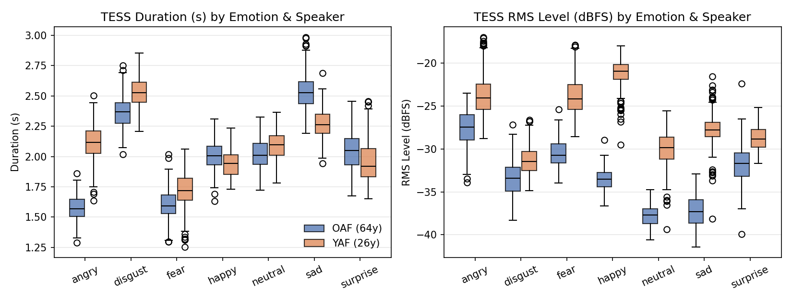
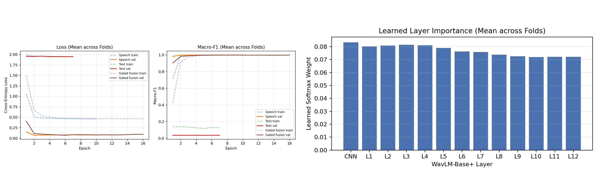
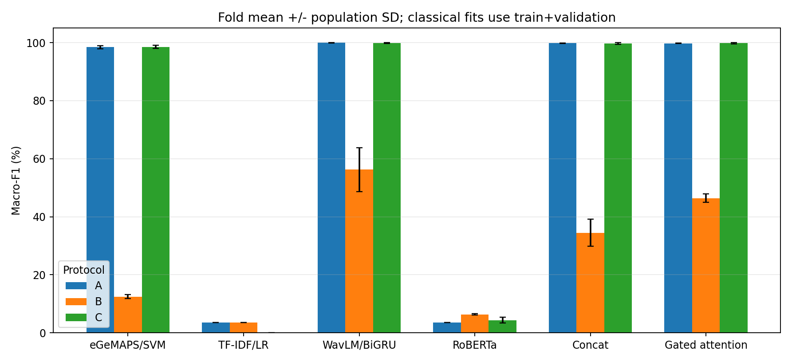
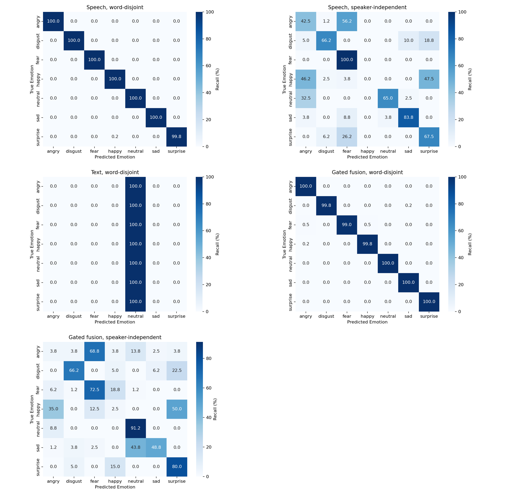
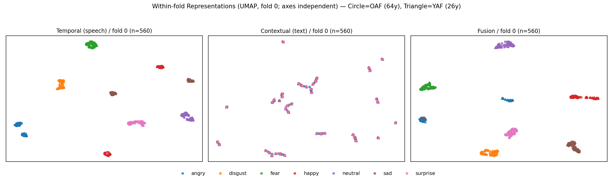
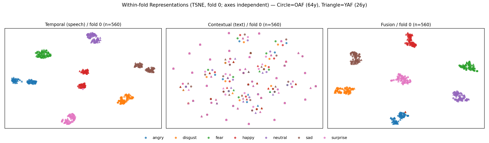

# Assignment 2B | Multimodal emotion recognition

**FINAL - required evidence gates passed.**

## Dataset, splits and completion

Four headline systems (speech, text, concat fusion, gated fusion) under A/B/C require 12 complete validated runs. Ongoing/partial jobs are pending, never completed results. Final checkpoint-to-prediction correspondence is checked by independent re-evaluation and before/after hashes. Historical text-training lineage was affected by concurrent writers; invalidated P0 markers are not adopted.

Metadata: 2800 clips; 2800 unique IDs; 200 words; 2 speakers. Class counts {'0': 400, '1': 400, '2': 400, '3': 400, '4': 400, '5': 400, '6': 400}. TESS uses two female speakers and seven acted emotions; filename-derived text is Say the word <target> after stripping speaker/emotion suffixes. Source [B6]: Borealis DOI 10.5683/SP2/E8H2MF. Keep data and repository private; retain source license/attribution.

| Protocol | Frozen split | Interpretation |
|---|---|---|
| A | 5 folds: 128/32/40 disjoint words | Primary lexical generalization; speakers shared |
| B | 2 folds: speaker transfer plus word disjoint; 40 test words | Stress test; two speakers limit generalization |
| C | 5 random stratified folds; ~70/10/20% | Optimistic reference; words and speakers shared |

Neural models fit training IDs and select best validation macro-F1 checkpoints. All models reuse frozen splits; no test tuning. Accuracy, UAR and macro-F1 are independently recomputed from saved test predictions. Tables show unweighted fold means +/- population fold SD (ddof=0), not confidence intervals.

| System | A | B | C |
|---|---|---|---|
| Speech | validated | validated | validated |
| Text | validated | validated | validated |
| Concat | validated | validated | validated |
| Gated | validated | validated | validated |

## Architecture and block justifications

| Block | Implementation | Justification / limitation |
|---|---|---|
| Speech preprocessing | 16 kHz mono; trim 30 dB, 50 ms padding; peak -1 dBFS | Standardizes rate/channel, retains boundary context. Normalization may alter loudness cues. |
| Speech features | Frozen WavLM-Base+ [B1], [13,T,768]; learned layer sum | Caching fits limited GPU memory; weights adapt layer contributions without encoder fine-tuning. |
| Temporal block | 256 projection; bidirectional GRU, 128 each direction; attentive mean/std [B2] | Models sequence dynamics, salience and feature dispersion rather than only a global average. |
| Text features | RoBERTa token embeddings [B3], max length 32 | Deterministic transcript; no filename emotion suffix is passed as input. |
| Contextual block | Top two transformer layers fine-tuned; 256 projection; masked attention pooling | Limits trainable parameters, preserves token context and produces fixed-size representation. |
| Fusion/classifier | Concat or bidirectional 4-head cross attention + vector gate, 256 dims; MLP -> 7 logits [B4,B5] | Concat comparator isolates fusion complexity. Cross attention exchanges sequence context; gate weights are descriptive, not causal. |

| Config | Batch | Epoch cap | Patience | Head LR | Encoder LR |
|---|---|---|---|---|---|
| speech | 32 | 40 | 8 | 0.001 | - |
| text | 32 | 20 | 6 | 0.001 | 2e-05 |
| fusion_concat | 32 | 40 | 8 | 0.001 | 2e-05 |
| fusion | 32 | 40 | 8 | 0.001 | 2e-05 |

Training settings are read from the current configuration files in the table. Implemented optimizer is AdamW with validation macro-F1 selection. See hashed configs for weight decay, smoothing, dropout and augmentation settings. Config snapshots are authoritative; report manifest hashes current config files. Gated mean closer to one weights the speech-side representation more, but cannot establish causal reliance.

References transcribed from PLAN.md: [B1] Chen et al., WavLM, IEEE JSTSP 2022, arXiv 2110.13900. [B2] Okabe et al., Attentive Statistics Pooling, Interspeech 2018, arXiv 1803.10963. [B3] Liu et al., RoBERTa, 2019, arXiv 1907.11692. [B4] Tsai et al., MulT, ACL 2019, arXiv 1906.00295. [B5] Arevalo et al., Gated Multimodal Units, ICLR-W 2017, arXiv 1702.01992. These motivate design; this implementation is not claimed to reproduce those papers.

## Validated accuracy comparison

Scores below are independently recomputed from frozen test predictions and checked against saved summaries and the final accuracy CSV. Each headline row has checkpoint-linked re-evaluation evidence. The historical concurrent-writer incident is retained; these are verified final-checkpoint results, not a reconstruction of the original text training lineage.

| System | Protocol | Accuracy % | UAR % | Macro-F1 % |
|---|---|---|---|---|
| Speech | A | 99.96 +/- 0.07 | 99.96 +/- 0.07 | 99.96 +/- 0.07 |
| Speech | B | 60.71 +/- 8.21 | 60.71 +/- 8.21 | 56.23 +/- 7.53 |
| Speech | C | 99.86 +/- 0.13 | 99.86 +/- 0.13 | 99.86 +/- 0.13 |
| Text | A | 14.29 +/- 0.00 | 14.29 +/- 0.00 | 3.57 +/- 0.00 |
| Text | B | 14.29 +/- 0.00 | 14.29 +/- 0.00 | 6.31 +/- 0.22 |
| Text | C | 14.25 +/- 0.62 | 14.25 +/- 0.62 | 4.34 +/- 0.97 |
| Concat | A | 99.82 +/- 0.11 | 99.82 +/- 0.11 | 99.82 +/- 0.11 |
| Concat | B | 43.75 +/- 5.89 | 43.75 +/- 5.89 | 34.44 +/- 4.66 |
| Concat | C | 99.71 +/- 0.27 | 99.71 +/- 0.27 | 99.72 +/- 0.27 |
| Gated | A | 99.79 +/- 0.13 | 99.79 +/- 0.13 | 99.79 +/- 0.13 |
| Gated | B | 52.14 +/- 5.36 | 52.14 +/- 5.36 | 46.40 +/- 1.44 |
| Gated | C | 99.82 +/- 0.28 | 99.82 +/- 0.28 | 99.82 +/- 0.28 |

## Emotion analysis and caveats

Fusion comparison: Concat minus speech macro-F1, A: -0.14 percentage points. Gated minus speech macro-F1, A: -0.18 percentage points. Concat minus speech macro-F1, B: -21.79 percentage points. Gated minus speech macro-F1, B: -9.84 percentage points. Concat minus speech macro-F1, C: -0.14 percentage points. Gated minus speech macro-F1, C: -0.04 percentage points.

Speech A easiest observed emotion by mean recall: angry (100.00%); hardest: surprise (99.75%). Ties are possible. These are descriptive ranks; why a label is easy/hard needs listening or controlled tests.

| Emotion | Speech B recall % | Gated B recall % |
|---|---|---|
| angry | 42.50 | 3.75 |
| disgust | 66.25 | 66.25 |
| fear | 100.00 | 72.50 |
| happy | 0.00 | 2.50 |
| neutral | 65.00 | 91.25 |
| sad | 83.75 | 48.75 |
| surprise | 67.50 | 80.00 |

Speaker transfer: speech fear recall is 100% but happiness is 0%; this class-specific collapse is hidden by near-ceiling Protocol A. Gated fusion helps neutral (+26.25 recall points) and surprise (+12.50), but corrects only 45 errors while introducing 93 errors overall in B. Thus selective benefit does not imply an aggregate gain. Different speaker-specific acoustic realizations are a plausible explanation, not a causal finding from two speakers.

Mean mixture gates: A=0.508, B=0.506, C=0.508. The two streams already contain cross-attended information, so gates are not causal text/speech contributions. Zero-text intervention: A: 91.96% accuracy/90.79% macro-F1; B: 54.64% accuracy/48.94% macro-F1. It does not reproduce speech-only performance in A. Modality dropout therefore did not establish the intended robustness; no test-tuned correction was made.

Fair-fit caveat: original classical baselines fit train+validation, while neural fits use train with validation selection. Train-only/direct-SVM audit comparisons are separate, not replacement E1 rows. Legacy SVM probability argmax can differ from direct prediction. Poor speaker-transfer similarity is consistent with feature shift, not proof of its sole cause.

Text audit: the full corpus pairs every transcript with all seven emotions, giving balanced population accuracy chance 1/7 and no intrinsic label information. This does not imply chance under every dependent finite partition. Classical text C 0% reflects complementary imbalance: each held-out true label is below its transcript's training-complement majority under train+validation fitting. Preserve frozen splits and original rows. Near-zero train-only audits and neural text results are distinct experiments; no universal macro-F1 chance threshold is assumed.

## Five actual failure cases

Five distinct actual error utterances are selected from Results/failure_cases.csv (or the B3 validated audit export in draft mode) and matched against validated headline predictions. Selection may emphasize confidence and is not an unbiased error-rate sample. No invented listening, F0 or causal explanation is attached.

| Run / fold | Utterance | True -> predicted | Confidence |
|---|---|---|---|
| speech_wavlm_bigru_asp / A f0 | OAF_make_surprise | surprise -> happy | 0.568 |
| speech_wavlm_bigru_asp / B f0 | YAF_fall_angry | angry -> fear | 0.825 |
| speech_wavlm_bigru_asp / B f1 | OAF_cool_happy | happy -> surprise | 0.763 |
| speech_wavlm_bigru_asp / B f1 | OAF_cool_neutral | neutral -> angry | 0.747 |
| speech_wavlm_bigru_asp / B f0 | YAF_week_happy | happy -> angry | 0.710 |

Per-case interpretation: each row is an observed label substitution with stated model confidence. Confidence is not correctness. Duration/F0 and acoustic shape are descriptive; claims about acting style, prosody or speaker causes remain hypotheses without recorded listening evidence.

## Three block embeddings and reproducibility

Required blocks: temporal (speech), contextual (text), fused (gated), from validated Protocol A embeddings. embedding_ids.csv makes correspondence explicit; newly re-evaluated arrays are explicitly linked to their test IDs and checkpoint hashes. Projections operate within a single fold; axes across panels are independent. Separation in a 2D projection is not independent evidence of predictive performance.

Reproduction: follow the component README. tools/complete_model_verification.py reuses saved completed runs, and tools/finalize_evaluation.py regenerates the final tables and figures. Build: python tools/build_reports.py --final --verification-root assignment_2b_emotion/Results/verified_p0. Independent checkpoints, input hashes and environment records support reproduction; historical invalidated markers are retained only for audit. All reports remain private; no audio, model caches, checkpoints or secrets in Git.

[B6] Pichora-Fuller & Dupuis, TESS, 2020. https://doi.org/10.5683/SP2/E8H2MF (reference from PLAN.md). All required headline runs, projections, failure cases and scoped Praat visual observations passed the final evidence gates. No manual gold boundary accuracy or population-level emotion-recognition generalization is claimed.

## Pending evidence

No pending requirements recorded.

